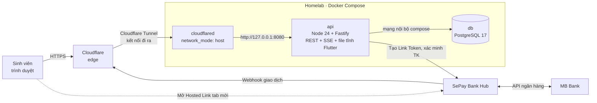
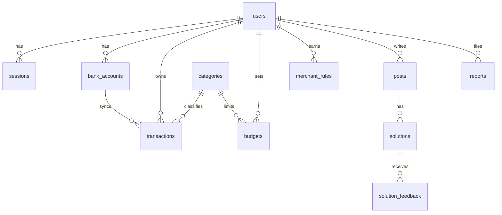
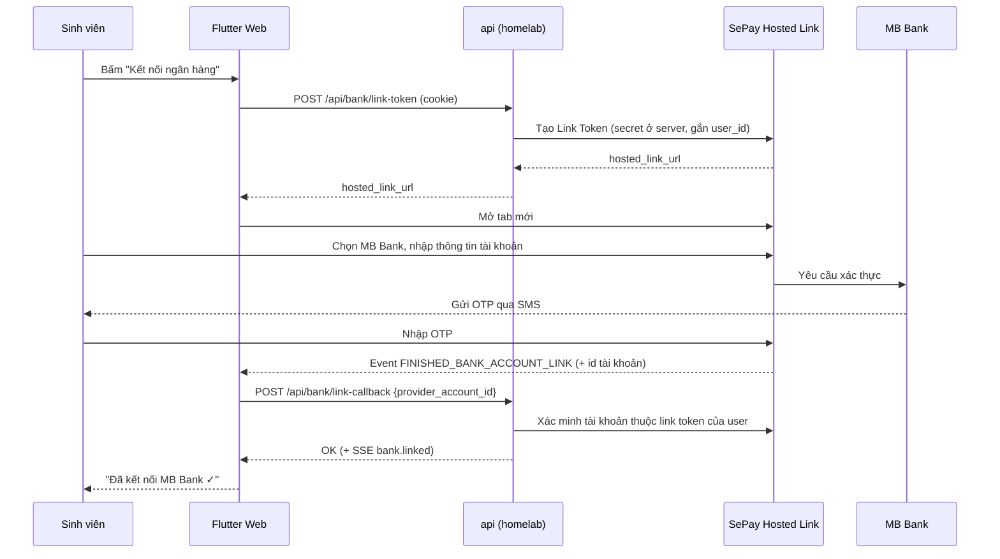

# Đặc tả hệ thống – App quản lý chi tiêu cho sinh viên (ITSS2)

> Tên tạm: **AnTâm Wallet**
> Nền tảng: **Flutter Web** + **Node.js 24 (Fastify) + PostgreSQL 17**, chạy bằng **Docker Compose trên homelab**, ra internet qua **Cloudflare Tunnel** + **SePay Bank Hub** (đồng bộ giao dịch MB Bank)
> Phiên bản tài liệu: v2.0 – 17/11/2026

**Thay đổi so với v1.0:** bỏ Supabase cloud và Vercel/Firebase, chuyển sang tự host trên homelab. Đăng nhập, phân quyền, realtime và các hàm backend nay nằm trong một service Node. Sửa các lỗi của v1: lộ `author_id`, bảng không có RLS, tác giả tự gỡ ẩn được bài, không xoá được tài khoản, `unique` với NULL, phân loại theo chuỗi con, thiếu cột cài đặt, múi giờ, webhook nuốt lỗi làm mất giao dịch.

---

## 0. Mục lục

1. Bối cảnh & mục tiêu
2. Phạm vi MVP
3. Kiến trúc tổng thể
4. Tech stack & lý do chọn
5. Cấu trúc thư mục
6. Thiết kế cơ sở dữ liệu
7. Backend – API
8. Tích hợp SePay Bank Hub
9. Logic nghiệp vụ (phân loại, ngân sách, đánh giá nhanh)
10. Chức năng ① – Vòng tròn "Đồng cảnh ngộ"
11. Chức năng ② – Hands-free Tracking
12. Danh sách màn hình & luồng UX
13. Nguyên tắc UX copy (giọng văn)
14. Chế độ Demo (không cần ngân hàng thật)
15. Bảo mật & quyền riêng tư
16. Biến môi trường
17. Cài đặt, deploy & vận hành trên homelab
18. Kế hoạch test
19. Lộ trình phát triển (sprint)
20. Rủi ro & phương án dự phòng

---

## 1. Bối cảnh & mục tiêu

### 1.1 Vấn đề
Sinh viên sống tự lập phải tự quản lý chi tiêu nhưng chưa có phương pháp phù hợp. Khó khăn thường phát sinh khi ăn uống bên ngoài, đi chơi, mua sắm online hoặc gặp khoản chi ngoài dự kiến → lo lắng, căng thẳng, ảnh hưởng học tập.

### 1.2 Hai thách thức (課題) và chức năng tương ứng

| 課題 | Nội dung | Chức năng chính |
|---|---|---|
| ① | Bình tĩnh đối diện khoản chi ngoài dự kiến / vượt ngân sách, vẫn cảm thấy an tâm | **Đánh giá nhanh + Vòng tròn "Đồng cảnh ngộ"** (cộng đồng ẩn danh) |
| ② | Quản lý chi tiêu theo nhịp độ riêng, không thấy là gánh nặng, có cảm giác thành tựu & tự tin | **Hands-free Tracking** (tự đồng bộ giao dịch ngân hàng) + **Phản hồi tích cực** |

### 1.3 Luồng giá trị xuyên suốt (nối 2 chức năng)

```
Thanh toán bằng MB Bank
  → SePay đồng bộ giao dịch (②)
  → Hệ thống tự phân loại, cập nhật ngân sách (②)
  → Nếu vượt ngân sách / chi bất thường → thông báo nhẹ nhàng, KHÔNG cảnh báo đỏ
  → Màn hình "Đánh giá nhanh" (①)
  → Gợi ý bài viết cùng hoàn cảnh trong "Đồng cảnh ngộ" (①)
```

---

## 2. Phạm vi MVP

### 2.1 Trong phạm vi (Must have)
- Đăng ký / đăng nhập bằng email + mật khẩu
- Onboarding: đặt ngân sách tháng + ngân sách theo nhóm, đánh dấu khoản "cần thiết" / "có thể điều chỉnh"
- Liên kết tài khoản ngân hàng qua SePay Bank Hub (Hosted Link)
- Nhận webhook giao dịch → lưu → tự phân loại → cập nhật realtime (SSE)
- Nhập nhanh thủ công (tiền mặt, ví MoMo/ZaloPay)
- Dashboard: còn lại bao nhiêu, chi theo nhóm (tuần / tháng)
- Đánh giá nhanh sau khoản chi lớn / vượt ngân sách
- Cộng đồng ẩn danh: đăng tình huống theo mẫu, đăng giải pháp, đánh dấu hữu ích, phản hồi kết quả, báo cáo
- Phản hồi tích cực hằng tuần (streak, so sánh với tuần trước)
- **Chế độ Demo**: giả lập giao dịch không cần ngân hàng

### 2.2 Ngoài phạm vi MVP (Later)
- Đăng nhập Google (cần OAuth client + cấu hình redirect)
- Quên mật khẩu qua email (homelab chưa có SMTP; tạm thời admin đặt lại bằng SQL, xem 17.6)
- App mobile native, đọc thông báo biến động số dư (Android)
- Chụp hóa đơn OCR
- Gamification nâng cao (cây, thú cưng)
- Đa ngôn ngữ (JP/VN), dark mode

---

## 3. Kiến trúc tổng thể



**Nguyên tắc:**
- **Một container `api`** vừa phục vụ API `/api/*` vừa phục vụ bản build Flutter Web. Trình duyệt và API **cùng origin**, nên ở production không cần CORS và cookie đăng nhập hoạt động bình thường.
- `api` chỉ nghe ở `127.0.0.1:8080` trên host (không mở ra LAN; cổng 8000 đã có dịch vụ khác trên server dùng). `db` **không publish cổng** nào, chỉ `api` gọi được qua mạng nội bộ của compose.
- Homelab nằm sau CGNAT nên không có kết nối vào. Mọi truy cập công khai (người dùng, webhook SePay) đi qua Cloudflare Tunnel `<tunnel>` có sẵn trên server.
- Flutter **không bao giờ** giữ secret của SePay hay mật khẩu DB. Mọi lời gọi SePay đi qua `api`.
- Phân quyền nằm trong `api`: mọi truy vấn dữ liệu cá nhân đều lọc theo `user_id` lấy từ phiên đăng nhập (xem 6.4).
- Webhook SePay → `POST /api/webhooks/sepay` → insert `transactions` → đẩy sự kiện SSE tới các tab đang mở của chủ giao dịch.

---

## 4. Tech stack & lý do chọn

| Lớp | Công nghệ | Lý do |
|---|---|---|
| Frontend | Flutter 3.x (Web) | Một codebase, build web để deploy; sau này build Android/iOS |
| State management | Riverpod | Đơn giản, test được |
| Routing | go_router + `usePathUrlStrategy()` | URL sạch trên web (`/community/post/123`, không có `#`) |
| HTTP / realtime (client) | `http` + `EventSource` (`package:web`) | Gọi REST; nhận SSE có sẵn trong trình duyệt, tự kết nối lại |
| Chart | fl_chart | Biểu đồ cột/tròn |
| Backend | Node.js 24 + Fastify | Node 24 chạy thẳng file `.ts` (type stripping), không cần bước build; Fastify có sẵn kiểm tra schema JSON |
| Thư viện backend | `fastify`, `@fastify/static`, `@fastify/cookie`, `@fastify/rate-limit`, `pg` | Chỉ 5 gói. Băm mật khẩu, token, HMAC dùng `node:crypto`; test dùng `node:test` |
| CSDL | PostgreSQL 17 (image `postgres:17-alpine`) | Có `unique nulls not distinct`, trigger, `timestamptz` |
| Realtime | Server-Sent Events | Một chiều server → client là đủ; đi qua Cloudflare Tunnel không cần cấu hình thêm |
| Ngân hàng | SePay Bank Hub | Hosted Link + webhook; MB Bank hỗ trợ đồng bộ tiền vào/ra |
| Hạ tầng | Docker Compose trên homelab + Cloudflare Tunnel | Miễn phí, HTTPS do Cloudflare cấp, không cần IP tĩnh hay mở cổng router |

**Ràng buộc khi viết TypeScript chạy thẳng trên Node 24:** import phải ghi đuôi `.ts` (`import { db } from "./db.ts"`); không dùng `enum`, `namespace`, parameter properties. `tsconfig.json` bật `erasableSyntaxOnly`, `allowImportingTsExtensions`, `noEmit`; lệnh `tsc --noEmit` chỉ dùng để kiểm tra kiểu khi dev.

---

## 5. Cấu trúc thư mục

```
ITSS2/
├── app/                          # Flutter project
│   ├── lib/
│   │   ├── main.dart             # gọi usePathUrlStrategy()
│   │   ├── core/
│   │   │   ├── env.dart          # đọc --dart-define (API_BASE_URL, APP_ENV)
│   │   │   ├── api_client.dart   # http + EventSource
│   │   │   ├── router.dart
│   │   │   ├── theme.dart        # màu dịu, không dùng đỏ cho cảnh báo
│   │   │   └── formatters.dart   # format VND
│   │   ├── data/
│   │   │   ├── models/           # Transaction, Budget, Category, Post, Solution...
│   │   │   └── repositories/     # gọi REST /api/*
│   │   ├── features/
│   │   │   ├── auth/  onboarding/  dashboard/  transactions/  bank_link/
│   │   │   ├── quick_check/      # Đánh giá nhanh (課題①)
│   │   │   ├── community/        # Đồng cảnh ngộ (課題①)
│   │   │   ├── weekly_review/    # Phản hồi tích cực (課題②)
│   │   │   ├── demo/             # Giả lập giao dịch
│   │   │   └── admin/
│   │   └── widgets/
│   ├── web/index.html
│   └── pubspec.yaml
├── server/
│   ├── src/
│   │   ├── main.ts               # khởi động Fastify, chạy migration, phục vụ file tĩnh
│   │   ├── db.ts                 # pg Pool + chạy migrations
│   │   ├── auth.ts               # scrypt, phiên, hook kiểm tra đăng nhập
│   │   ├── events.ts             # SSE
│   │   ├── classify.ts           # phân loại (mục 9.1)
│   │   ├── budget.ts             # tính ngân sách, quick check, weekly review (mục 9.2–9.3, 11.4)
│   │   ├── sepay.ts              # gọi SePay + webhook
│   │   ├── routes/               # auth, me, budgets, transactions, community, bank, demo, admin
│   │   └── tools/set-password.ts # đặt lại mật khẩu bằng tay (17.6)
│   ├── test/                     # node:test – classify, budget (không cần DB)
│   ├── migrations/
│   │   ├── 0001_schema.sql
│   │   ├── 0002_seed_categories.sql
│   │   └── 0003_seed_community.sql
│   ├── db-init/00-app-role.sh    # tạo role antam_app (chỉ chạy lần đầu tạo volume)
│   ├── package.json
│   └── tsconfig.json
├── scripts/backup.sh
├── Dockerfile                    # multi-stage: flutter build → test → node runtime
├── compose.yaml
├── deploy.sh
├── .env.example
├── .gitattributes                # *.sh text eol=lf (máy Windows checkout ra CRLF là script hỏng)
├── .gitignore                    # .env, backup.log, app/build/, node_modules/
└── SYSTEM_SPEC.md                # file này
```

---

## 6. Thiết kế cơ sở dữ liệu

### 6.1 ERD tóm tắt



### 6.2 Schema SQL (`0001_schema.sql`)

```sql
-- Người dùng (thay cho auth.users + profiles của Supabase)
create table users (
  id uuid primary key default gen_random_uuid(),
  email text unique check (email = lower(email)), -- null = tài khoản seed (tác giả bài mẫu)
  password_hash text,                    -- 'scrypt$N$r$p$salt$hash'; null = không đăng nhập được
  display_name text,
  anon_alias text not null unique,       -- tên ẩn danh trong cộng đồng, vd "Mèo Mướp #4821"
  role text not null default 'user' check (role in ('user','admin')),
  monthly_income_day int not null default 1 check (monthly_income_day between 1 and 31),
  demo_mode boolean not null default false,     -- bật tab /demo (mục 14)
  exclude_topup boolean not null default false, -- loại 'topup' khỏi tổng chi (mục 11.3)
  created_at timestamptz not null default now()
);

-- Phiên đăng nhập: chỉ lưu SHA-256 của token, token thật nằm trong cookie
create table sessions (
  token_hash bytea primary key,
  user_id uuid not null references users(id) on delete cascade,
  expires_at timestamptz not null,
  created_at timestamptz not null default now()
);
create index on sessions (user_id);

-- Nhóm chi tiêu
create table categories (
  id serial primary key,
  code text unique not null,             -- food, transport, shopping, rent, study, fun, topup, other, income
  name_vi text not null,
  icon text,
  default_essential boolean not null default false
);

-- Ngân sách theo tháng & theo nhóm
create table budgets (
  id uuid primary key default gen_random_uuid(),
  user_id uuid not null references users(id) on delete cascade,
  month date not null check (extract(day from month) = 1),  -- ngày đầu tháng, vd 2026-11-01
  category_id int references categories(id),               -- null = tổng ngân sách tháng
  amount bigint not null check (amount >= 0),
  is_essential boolean not null default false,
  unique nulls not distinct (user_id, month, category_id)  -- chỉ 1 dòng tổng (category_id null) mỗi tháng
);

-- Tài khoản ngân hàng đã liên kết qua SePay
create table bank_accounts (
  id uuid primary key default gen_random_uuid(),
  user_id uuid not null references users(id) on delete cascade,
  provider text not null default 'sepay',
  provider_account_id text,              -- id tài khoản phía SePay Bank Hub (đã xác minh với SePay)
  account_number_hmac text,              -- HMAC-SHA256(số TK, ACCOUNT_HASH_SECRET), dùng cho webhook SePay thường
  bank_short_name text,                  -- 'MBBank'
  account_number_masked text,            -- '****6789'
  status text not null default 'active' check (status in ('active','unlinked')),
  linked_at timestamptz not null default now(),
  unique (provider, provider_account_id),
  unique (provider, account_number_hmac),
  check (provider_account_id is not null or account_number_hmac is not null)
);

-- Giao dịch
create table transactions (
  id uuid primary key default gen_random_uuid(),
  user_id uuid not null references users(id) on delete cascade,
  bank_account_id uuid references bank_accounts(id) on delete set null,
  source text not null check (source in ('sepay','manual','demo')),
  wallet text check (wallet in ('cash','momo','zalopay','other')),  -- chỉ dùng cho source='manual'
  external_id text,                      -- id giao dịch phía SePay (chống trùng)
  direction text not null check (direction in ('in','out')),
  amount bigint not null check (amount > 0),   -- VND, luôn dương
  occurred_at timestamptz not null,
  raw_content text,                      -- nội dung chuyển khoản gốc
  counterparty text,                     -- tên người nhận / cửa hàng (nếu tách được)
  category_id int references categories(id),
  category_confirmed boolean not null default false,  -- user đã xác nhận nhóm chưa
  note text,
  balance_after bigint,                  -- số dư sau giao dịch (từ ngân hàng)
  created_at timestamptz not null default now(),
  unique (source, external_id)           -- manual có external_id null → không đụng nhau
);
create index on transactions (user_id, occurred_at desc);

-- Quy tắc phân loại học từ người dùng
create table merchant_rules (
  id uuid primary key default gen_random_uuid(),
  user_id uuid not null references users(id) on delete cascade,
  pattern text not null check (char_length(pattern) >= 3),  -- cụm token đã chuẩn hoá: 'highlands', 'quan co ba'
  category_id int not null references categories(id),
  hits int not null default 1,
  unique (user_id, pattern)
);

-- Log webhook (debug & audit). Chỉ server đọc; số tài khoản bị che trước khi lưu.
create table webhook_logs (
  id bigserial primary key,
  received_at timestamptz not null default now(),
  payload jsonb not null,
  status text not null default 'received'
    check (status in ('received','ok','duplicate','unknown_account','error')),
  error text
);

-- ===== Cộng đồng "Đồng cảnh ngộ" =====
create table posts (
  id uuid primary key default gen_random_uuid(),
  author_id uuid not null references users(id) on delete cascade,
  difficulty_type text not null check (difficulty_type in ('unexpected_expense','over_budget','income_delay','other')),
  expense_type text check (expense_type in ('medical','device_broken','social','tuition','other')),
  amount_range text check (amount_range in ('<200k','200k-500k','500k-1tr','>1tr')),
  need text not null check (need in ('meal_ideas','budget_adjust','side_job','emotional','other')),
  body text not null check (char_length(body) between 20 and 1000),
  status text not null default 'visible' check (status in ('visible','hidden','removed')),
  created_at timestamptz not null default now()
);

create table solutions (
  id uuid primary key default gen_random_uuid(),
  post_id uuid references posts(id) on delete cascade,  -- null = mẹo chung
  author_id uuid not null references users(id) on delete cascade,
  tag text not null check (tag in ('cheap_meal','adjust_plan','side_job','mindset')),
  body text not null check (char_length(body) between 10 and 1000),
  status text not null default 'visible' check (status in ('visible','hidden','removed')),
  created_at timestamptz not null default now()
);

create table solution_feedback (
  solution_id uuid references solutions(id) on delete cascade,
  user_id uuid references users(id) on delete cascade,
  helpful boolean not null,
  applied_result text check (applied_result in ('worked','partly','not_worked')),
  comment text check (char_length(comment) <= 500),
  created_at timestamptz not null default now(),
  primary key (solution_id, user_id)
);

create table reports (
  id uuid primary key default gen_random_uuid(),
  reporter_id uuid not null references users(id) on delete cascade,
  target_type text not null check (target_type in ('post','solution')),
  target_id uuid not null,
  reason text not null check (reason in ('scam_loan','spam','offensive','personal_info','other')),
  detail text check (char_length(detail) <= 500),
  status text not null default 'open' check (status in ('open','resolved','dismissed')),
  created_at timestamptz not null default now(),
  unique (reporter_id, target_type, target_id)
);

-- View công khai: KHÔNG có author_id. API cộng đồng chỉ đọc từ 2 view này.
create view public_posts as
  select p.id, u.anon_alias, p.difficulty_type, p.expense_type, p.amount_range,
         p.need, p.body, p.created_at,
         (select count(*) from solutions s where s.post_id = p.id and s.status = 'visible') as solution_count
  from posts p join users u on u.id = p.author_id
  where p.status = 'visible';

create view public_solutions as
  select s.id, s.post_id, u.anon_alias, s.tag, s.body, s.created_at,
         count(*) filter (where f.helpful)                  as helpful_count,
         count(*) filter (where f.applied_result = 'worked') as worked_count
  from solutions s
  join users u on u.id = s.author_id
  left join solution_feedback f on f.solution_id = s.id
  where s.status = 'visible'
  group by s.id, u.anon_alias;
```

> Đã bỏ so với v1: bảng `profiles` (gộp vào `users`), `weekly_reviews` (tính trực tiếp, mục 11.4), cột `helpful_count` (đếm trong view). Ở quy mô đồ án, đếm khi truy vấn đủ nhanh và không bao giờ lệch số.

### 6.3 Seed nhóm chi tiêu (`0002_seed_categories.sql`)

```sql
insert into categories (code, name_vi, icon, default_essential) values
 ('food','Ăn uống','🍜',true),
 ('rent','Nhà ở & điện nước','🏠',true),
 ('transport','Đi lại','🛵',true),
 ('study','Học tập','📚',true),
 ('shopping','Mua sắm','🛍️',false),
 ('fun','Giải trí & bạn bè','🎉',false),
 ('topup','Nạp ví điện tử','📱',false),
 ('other','Khác','📦',false),
 ('income','Tiền vào','💰',false);
```

`0003_seed_community.sql`: tạo khoảng 10 tài khoản seed (`email` và `password_hash` để null, `anon_alias` cố định) cùng 15–20 bài và giải pháp mẫu (mục 10.4).

### 6.4 Quy tắc phân quyền trong API (thay cho RLS của Supabase)

Ứng dụng kết nối DB bằng role thường `antam_app` (không phải superuser), là chủ sở hữu các bảng. Không dùng RLS mà áp các quy tắc sau trong API:

| Dữ liệu | Đọc | Ghi |
|---|---|---|
| `users` (của mình) | `/api/me` | `PATCH /api/me`: chỉ `display_name`, `monthly_income_day`, `demo_mode`, `exclude_topup`. **Không bao giờ** sửa được `role` |
| `transactions`, `budgets`, `merchant_rules`, `bank_accounts` | Luôn `where user_id = $1` với `$1` lấy từ phiên. Sai chủ → **404** (không tiết lộ là bản ghi có tồn tại) | Như trên. `POST /api/transactions` luôn ép `source='manual'`; `bank_accounts` chỉ server ghi sau khi xác minh với SePay |
| `posts`, `solutions` | Chỉ qua view `public_posts` / `public_solutions` (không có `author_id`) | Tác giả: tạo, sửa **chỉ `body`**, xoá bài của mình. **Chỉ admin** đổi `status` |
| `solution_feedback`, `reports` | Không trả danh sách cho người dùng thường | Mỗi người 1 dòng (khoá chính / unique) |
| `webhook_logs`, `sessions` | Không có endpoint nào | Chỉ server |
| Admin (`role='admin'`) | `/api/admin/*` kiểm `role` ở mọi request | Admin đầu tiên đặt bằng SQL (17.6) |

### 6.5 Trigger tự ẩn bài khi bị báo cáo nhiều

```sql
create function auto_hide_on_reports() returns trigger language plpgsql as $$
begin
  if (select count(*) from reports
      where target_type = new.target_type and target_id = new.target_id and status = 'open') >= 3 then
    if new.target_type = 'post' then
      update posts set status = 'hidden' where id = new.target_id and status = 'visible';
    else
      update solutions set status = 'hidden' where id = new.target_id and status = 'visible';
    end if;
  end if;
  return new;
end $$;

create trigger trg_auto_hide after insert on reports
for each row execute function auto_hide_on_reports();
```

> Không cần `security definer` vì API chạy bằng chính chủ bảng. Điều kiện `status = 'visible'` để trigger không biến bài đã `removed` thành `hidden`. Khi admin khôi phục bài, các báo cáo `open` của bài đó chuyển sang `dismissed`; nếu không, báo cáo kế tiếp sẽ ẩn bài lại ngay.

### 6.6 Migration
- Mỗi file `server/migrations/NNNN_ten.sql` chạy **đúng một lần**, theo thứ tự tên file, mỗi file trong một transaction. Tên file đã chạy được ghi vào bảng `schema_migrations(name text primary key, applied_at timestamptz)`.
- `api` tự chạy các migration còn thiếu lúc khởi động, trước khi nhận request. `// ponytail: chỉ 1 instance api; chạy nhiều instance thì bọc bằng pg_advisory_lock`.
- **Không sửa file migration đã deploy**, muốn đổi thì thêm file mới. Chỉ thêm (cột, bảng), không xoá trong cùng lần deploy, để image cũ (`antam-api:truoc`, mục 17.5) vẫn chạy được trên schema mới khi phải quay lui.

---

## 7. Backend – API

Tất cả nằm dưới `/api`, trao đổi JSON. Body phải là `application/json` (parser `text/plain` mặc định của Fastify bị tắt). Đăng nhập bằng cookie `sid` (mục 15). Ký hiệu cột "Auth": 🔓 công khai, 👤 cần đăng nhập, 🛡️ admin, 🔑 API key của SePay.

| Nhóm | Method & đường dẫn | Auth | Mô tả |
|---|---|---|---|
| Hệ thống | `GET /api/health` | 🔓 | `{ok:true}` khi DB trả lời; dùng cho healthcheck |
| Auth | `POST /api/auth/register` | 🔓 | `{email,password,display_name}` → tạo user + `anon_alias` ngẫu nhiên (trùng thì sinh lại), đặt cookie. Mật khẩu ≥ 8 ký tự |
| | `POST /api/auth/login` | 🔓 | Đúng → tạo phiên, đặt cookie. Sai → 401 với một thông báo chung (không nói sai email hay sai mật khẩu) |
| | `POST /api/auth/logout` | 👤 | Xoá phiên, xoá cookie |
| Tài khoản | `GET /api/me` · `PATCH /api/me` | 👤 | Hồ sơ + cài đặt (6.4) |
| | `DELETE /api/me` | 👤 | Body `{password}` → xoá user, cascade toàn bộ dữ liệu |
| Danh mục | `GET /api/categories` | 👤 | |
| Ngân sách | `GET /api/budgets?month=2026-11` | 👤 | |
| | `PUT /api/budgets?month=2026-11` | 👤 | Thay toàn bộ ngân sách của tháng đó trong 1 transaction |
| Giao dịch | `GET /api/transactions?from&to&category_id&before` | 👤 | Phân trang theo `occurred_at` (`before` = con trỏ), 50 dòng/trang |
| | `POST /api/transactions` | 👤 | Nhập tay `{direction,amount,category_id,wallet,occurred_at?,note?}`, `source='manual'` |
| | `PATCH /api/transactions/:id` | 👤 | `{category_id?, note?}`. Đổi nhóm → `category_confirmed=true` + upsert `merchant_rules` (9.1) |
| | `DELETE /api/transactions/:id` · `DELETE /api/transactions` | 👤 | Xoá một / toàn bộ giao dịch của mình |
| Tổng hợp | `GET /api/summary?period=week\|month` | 👤 | Còn lại, an toàn mỗi ngày, chi theo nhóm, số giao dịch chờ xác nhận nhóm (9.2) |
| | `GET /api/quick-check` | 👤 | 3 con số + mức độ + các nhóm có thể điều chỉnh (9.3) |
| | `GET /api/review/weekly` | 👤 | Tổng kết tuần trước, streak, huy hiệu (11.4) |
| Realtime | `GET /api/events` | 👤 | SSE: `transaction.created`, `quick_check.suggested`, `bank.linked`; ping 30 giây/lần |
| Ngân hàng | `GET /api/bank/accounts` | 👤 | |
| | `POST /api/bank/link-token` | 👤 | `{purpose:'LINK_BANK_ACCOUNT'\|'UNLINK_BANK_ACCOUNT', bank_account_id?}` → `{hosted_link_url, expires_at}` (8.1) |
| | `POST /api/bank/link-callback` | 👤 | `{provider_account_id}`. Server **gọi SePay xác minh** tài khoản thuộc phiên liên kết của user này, xong mới upsert `bank_accounts` (không tin metadata client gửi) |
| | `POST /api/webhooks/sepay` | 🔑 | Nhận giao dịch mới (7.1) |
| Demo | `POST /api/demo/transactions` | 👤 | Chỉ khi `APP_ENV=demo` và `users.demo_mode=true`. `{direction,amount,content}` (7.2) |
| | `POST /api/demo/seed` · `DELETE /api/demo/transactions` | 👤 | Tạo 2 tuần dữ liệu mẫu / xoá mọi giao dịch `source='demo'` của mình |
| Cộng đồng | `GET /api/community/posts?difficulty_type&amount_range&need&before&mine` | 👤 | Từ `public_posts`; `mine=1` lọc bài của mình (lọc theo `author_id` ở server, không trả cột này) |
| | `GET /api/community/posts/:id` | 👤 | Bài + giải pháp (`public_solutions`) |
| | `POST /api/community/posts` · `PATCH …/:id` · `DELETE …/:id` | 👤 | Tạo / sửa `body` / xoá bài của mình. Có bộ lọc nội dung (10.2) |
| | `POST /api/community/solutions` | 👤 | `{post_id\|null, tag, body}`, cũng qua bộ lọc nội dung |
| | `GET /api/community/tips` | 👤 | Giải pháp `post_id is null`, xếp theo `helpful_count` |
| | `PUT /api/community/solutions/:id/feedback` | 👤 | `{helpful, applied_result?, comment?}`, upsert |
| | `POST /api/community/reports` | 👤 | `{target_type,target_id,reason,detail?}`; trùng → 200 (không báo lỗi) |
| Admin | `GET /api/admin/reports?status=open` | 🛡️ | Gom theo đối tượng bị báo cáo |
| | `POST /api/admin/:target_type/:id/restore` | 🛡️ | `status='visible'`, các báo cáo open → `dismissed` |
| | `POST /api/admin/:target_type/:id/remove` | 🛡️ | `status='removed'`, các báo cáo open → `resolved` |

Mọi lỗi trả về `{error: "<mã>", message: "<câu tiếng Việt nhẹ nhàng>"}`.

### 7.1 `POST /api/webhooks/sepay` – pseudo-code

```ts
app.post("/api/webhooks/sepay", async (req, reply) => {
  // 1. Xác thực. Sai key → 401, KHÔNG ghi DB (không cho người lạ làm phình bảng log)
  if (!apiKeyOk(req.headers.authorization)) return reply.code(401).send();

  const p = req.body as SepayPayload;
  const { rows: [log] } = await db.query(
    "insert into webhook_logs (payload) values ($1) returning id", [maskAccountNumber(p)]);

  try {
    const status = await handle(p);              // 'ok' | 'duplicate' | 'unknown_account'
    await db.query("update webhook_logs set status = $2 where id = $1", [log.id, status]);
    return { success: true };                    // 200: SePay coi là đã nhận
  } catch (e) {
    await db.query("update webhook_logs set status = 'error', error = $2 where id = $1", [log.id, String(e)]);
    return reply.code(500).send({ success: false });  // 5xx → SePay gửi lại; nhờ unique(source, external_id) nên gửi lại không bị trùng
  }
});

async function handle(p: SepayPayload) {
  // 2. Tìm tài khoản: theo id tài khoản Bank Hub, hoặc HMAC số TK (webhook SePay thường)
  const acc = await findActiveAccount(p);        // ... where status = 'active'
  if (!acc) return "unknown_account";            // vẫn 200 để SePay không retry vô hạn

  // 3. Chuẩn hoá
  const direction = p.transferType === "out" ? "out" : "in";
  const content = String(p.content ?? p.description ?? "");
  const counterparty = extractCounterparty(content);

  // 4. Phân loại (mục 9.1)
  const categoryId = direction === "in" ? INCOME_ID : await classify(acc.user_id, counterparty ?? content);

  // 5. Insert, chống trùng
  const { rows } = await db.query(
    `insert into transactions (user_id, bank_account_id, source, external_id, direction, amount,
       occurred_at, raw_content, counterparty, category_id, balance_after)
     values ($1,$2,'sepay',$3,$4,$5,$6,$7,$8,$9,$10)
     on conflict (source, external_id) do nothing returning *`,
    [acc.user_id, acc.id, String(p.id), direction, Math.abs(Number(p.transferAmount)),
     p.transactionDate + "+07:00",              // SePay gửi giờ VN không kèm múi giờ
     content, counterparty, categoryId, p.accumulated ?? null]);
  if (rows.length === 0) return "duplicate";

  events.emit(acc.user_id, "transaction.created", rows[0]);   // SSE (mục 11.2)
  await maybeSuggestQuickCheck(acc.user_id, rows[0]);         // mục 9.3
  return "ok";
}

// So khoá hằng thời gian: băm cả hai về SHA-256 để cùng độ dài rồi timingSafeEqual
function apiKeyOk(header?: string) {
  const h = (s: string) => createHash("sha256").update(s).digest();
  return timingSafeEqual(h(header ?? ""), h(`Apikey ${process.env.SEPAY_WEBHOOK_API_KEY}`));
}
```

**Payload webhook tham khảo** (đối chiếu lại docs SePay; với Bank Hub cần xác định trường id tài khoản dùng cho `findActiveAccount`):

```json
{
  "id": 92704,
  "gateway": "MBBank",
  "transactionDate": "2026-11-17 12:30:05",
  "accountNumber": "0123456789",
  "content": "NGUYEN VAN NAM chuyen tien tra sua",
  "transferType": "out",
  "transferAmount": 35000,
  "accumulated": 1250000,
  "referenceCode": "FT26321XXXX",
  "description": "..."
}
```

> ⚠️ Tên endpoint, header xác thực (`Authorization: Apikey …`), cách SePay retry và tên trường chính xác: **đối chiếu tài liệu SePay** (Phụ lục A) trước khi code. Tài liệu này chỉ mô tả luồng.

### 7.2 `POST /api/demo/transactions`

**Request:** `{ "direction": "out", "amount": 35000, "content": "THANH TOAN QR HIGHLANDS COFFEE" }`
**Xử lý:** giống bước 3–5 của webhook, với `source='demo'`, `external_id = randomUUID()`, `occurred_at = now()`. Dùng chung `classify`, `events.emit`, `maybeSuggestQuickCheck`. Vì đi cùng một đường code với webhook, demo giống hệt giao dịch thật.

### 7.3 Realtime (SSE)
- `GET /api/events` giữ kết nối mở, gửi `event: <tên>\ndata: <json>\n\n`. Cứ 30 giây gửi dòng `: ping` để Cloudflare không cắt kết nối rảnh (giới hạn khoảng 100 giây).
- Server giữ `Map<user_id, Set<kết nối>>` trong bộ nhớ; `events.emit(userId, …)` ghi tới mọi tab của user đó. `// ponytail: chỉ đúng với 1 instance api; nhiều instance thì chuyển sang Postgres LISTEN/NOTIFY`.
- Không bật nén (gzip) cho route này, vì nén sẽ gom dữ liệu lại và làm chậm sự kiện.

---

## 8. Tích hợp SePay Bank Hub

### 8.1 Luồng liên kết tài khoản



### 8.2 Hiển thị Hosted Link trên Flutter Web
- **Tab mới (dùng cách này):** `url_launcher` mở `hosted_link_url` với `webOnlyWindowName: '_blank'`. Liên kết xong, người dùng quay lại tab app; app nhận SSE `bank.linked` hoặc tự làm mới `GET /api/bank/accounts` khi tab được focus lại.
- Thêm `https://<domain>` vào danh sách domain được phép / redirect URL trong cấu hình Bank Hub (nếu SePay yêu cầu).
- Nhúng iframe: chưa làm. Chỉ cân nhắc nếu tab mới gây khó chịu trong usability test, vì trang xác thực ngân hàng thường chặn bị nhúng iframe.

### 8.3 Cấu hình webhook trên SePay
- URL: `https://<domain>/api/webhooks/sepay`
- Xác thực: API Key (đặt vào `SEPAY_WEBHOOK_API_KEY`)
- Bật đồng bộ **tiền vào** và **tiền ra**
- Tắt bộ lọc "chỉ giao dịch có mã thanh toán" (vì ta cần mọi giao dịch)
- Nếu sau này bật Cloudflare Access cho domain, **phải loại trừ** đường dẫn `/api/webhooks/*`, vì SePay không đăng nhập Access được.

### 8.4 Ghi chú về MB Bank
- MB Bank cá nhân: hỗ trợ tài khoản chính + đồng bộ tiền vào/ra qua SePay.
- Sandbox cho MB chưa xác nhận → khi demo dùng **Chế độ Demo** (mục 14) hoặc tài khoản demo SePay + "Giả lập giao dịch".
- Hủy liên kết: tạo Link Token với `purpose = UNLINK_BANK_ACCOUNT` → `bank_accounts.status = 'unlinked'`. Liên kết lại cùng tài khoản → upsert theo `(provider, provider_account_id)`, đặt lại `user_id` và `status='active'` sau khi đã xác minh.
- Phương án không dùng Bank Hub (mục 19): webhook SePay thường của tài khoản nhóm. Server so `account_number_hmac` = HMAC-SHA256(`accountNumber`, `ACCOUNT_HASH_SECRET`). Không dùng SHA-256 trần, vì số tài khoản chỉ có khoảng 10^10 khả năng nên dò ngược được.

---

## 9. Logic nghiệp vụ

Mọi ranh giới ngày / tuần / tháng tính theo giờ **Asia/Ho_Chi_Minh**: trong SQL dùng `date_trunc('month', occurred_at at time zone 'Asia/Ho_Chi_Minh')`, tuần bắt đầu thứ Hai. Container chạy với `TZ=Asia/Ho_Chi_Minh`.

### 9.1 Phân loại giao dịch tự động

**Chuẩn hoá và tách token:**

```ts
function tokens(s: string): string[] {
  return s.normalize("NFD").replace(/\p{M}/gu, "")      // bỏ dấu
          .replace(/đ/g, "d").replace(/Đ/g, "D").toLowerCase()
          .split(/[^a-z0-9]+/).filter(Boolean);         // "GRAB*TRIP" → ["grab","trip"]
}
```

Một pattern (vd `"tra sua"`) **khớp** khi các token của nó xuất hiện **liên tiếp và nguyên vẹn** trong danh sách token của nội dung. Nhờ vậy `be` không khớp `"bep"`, còn `com` không khớp `"combo"`.

Thứ tự ưu tiên:
1. **Quy tắc người dùng** (`merchant_rules`).
2. **Từ điển chung** (hard-code trong `classify.ts`).

Trong mỗi nguồn, pattern **nhiều token hơn thắng** (`grab food` thắng `grab`).

| Pattern (đã bỏ dấu) | Nhóm |
|---|---|
| highlands, phuc long, tra sua, tocotoco, com tam, com ga, quan com, pho, bun, banh mi, grabfood, grab food, shopeefood, shopee food, baemin, circle k, winmart, bach hoa xanh | food |
| grab, be bike, be car, xanh sm, gojek, xang, petrolimex, gui xe | transport |
| shopee, lazada, tiki, tiktok shop | shopping |
| tien nha, tien phong, tien dien, tien nuoc, wifi, internet | rent |
| hoc phi, sach, photo, in tai lieu | study |
| cgv, lotte cinema, karaoke, steam, garena | fun |
| nap momo, momo, zalopay, nap vi | topup |

3. **Không khớp** → `other`, `category_confirmed = false` → app hiện thẻ "Khoản này thuộc nhóm nào?" (1 chạm).

**Học từ người dùng** (khi `PATCH /api/transactions/:id` đổi nhóm): pattern = token của `counterparty`; nếu không có thì lấy token của nội dung sau khi bỏ stop-word (`thanh`, `toan`, `qr`, `chuyen`, `tien`, `ck`, `ft…`, mọi token toàn chữ số). Pattern ngắn hơn 3 ký tự thì **không học** (để tránh quy tắc kiểu `"qr"` nuốt mọi giao dịch). Upsert `merchant_rules(user_id, pattern)` → `hits + 1`.

> `// ponytail: từ điển hard-code + so token, đủ cho đồ án. Khi phân loại sai nhiều thì thêm pattern hoặc dùng counterparty tốt hơn, chưa cần ML.`

### 9.2 Tính ngân sách

```
chi(kỳ)           = Σ amount của giao dịch out trong kỳ
                    (bỏ nhóm 'topup' nếu users.exclude_topup = true – mục 11.3)
remaining_month   = budget_total(month) − chi(month)
remaining_cat     = budget(cat, month) − chi(cat, month)
days_left         = max(1, số ngày từ hôm nay đến ngày nhận tiền tiếp theo)
                    (monthly_income_day lớn hơn số ngày của tháng → lấy ngày cuối tháng)
safe_per_day      = max(0, remaining_month − essential_left) / days_left
```

`essential_left` = tổng phần **còn lại** (không âm) của các nhóm có `is_essential = true`.

### 9.3 Đánh giá nhanh (Quick Check) – 課題①

**Gợi ý mở** (server đẩy SSE `quick_check.suggested` sau khi có giao dịch mới) khi có bất kỳ điều kiện nào:
- Một giao dịch `out` ≥ 20% ngân sách tháng
- Một giao dịch `out` ≥ 3 × trung bình một giao dịch của user (chỉ xét khi đã có ≥ 5 giao dịch chi, tránh báo nhầm với người mới)
- `remaining_month` chuyển từ dương sang âm
- Người dùng tự bấm "Mình vừa có khoản chi bất ngờ"

**Kết quả hiển thị (3 con số + 1 kết luận):**

| Mục | Công thức |
|---|---|
| Số tiền hiện có | `balance_after` mới nhất (hoặc ước tính = thu − chi trong tháng) |
| Khoản cần thiết còn lại | `essential_left` |
| Có thể dùng đến cuối kỳ | `available = số tiền hiện có − essential_left` |

**Mức độ ảnh hưởng:**

| Điều kiện | Mức | Thông điệp (giọng nhẹ nhàng) |
|---|---|---|
| `available / days_left ≥ 50k` | Nhẹ | "Bạn vẫn ổn. Mỗi ngày còn khoảng {x}đ để chi linh hoạt." |
| `0 < available / days_left < 50k` | Vừa | "Hơi chật một chút, nhưng xoay được. Thử điều chỉnh vài khoản bên dưới nhé." |
| `available ≤ 0` | Cần hỗ trợ | "Tháng này sẽ hơi khó. Mình cùng xem có thể lùi khoản nào, và các bạn khác đã xoay xở thế nào." |

**Gợi ý điều chỉnh:** liệt kê các nhóm `is_essential = false` còn dư ngân sách, cho phép giảm bằng slider → tính lại ngay ở client; bấm "Lưu" → `PUT /api/budgets`.
**Nút cuối:** "Xem các bạn từng gặp chuyện tương tự" → mở Cộng đồng, lọc theo `difficulty_type` + `amount_range` tương ứng.

---

## 10. Chức năng ① – Vòng tròn "Đồng cảnh ngộ"

### 10.1 Tính năng tối thiểu
1. **Chia sẻ tình huống ẩn danh theo mẫu**: loại khó khăn, khoản chi phát sinh, khoảng số tiền, nhu cầu hỗ trợ, mô tả ngắn.
2. **Đăng & tìm giải pháp ngắn hạn** theo tag: bữa ăn tiết kiệm / điều chỉnh chi tiêu / việc làm thêm / tinh thần.
3. **Đánh dấu hữu ích & phản hồi kết quả áp dụng** ("Đã thử – hiệu quả / một phần / không hiệu quả").
4. **Báo cáo nội dung gây hại & kiểm duyệt**.

### 10.2 Quy tắc ẩn danh
- Chỉ hiển thị `anon_alias` (sinh ngẫu nhiên lúc đăng ký: tên con vật + số 4 chữ số).
- Không hiển thị số tiền chính xác → dùng `amount_range`.
- API cộng đồng chỉ đọc từ view `public_posts` / `public_solutions`, nên **không response nào chứa `author_id`**.
- **Bộ lọc nội dung chạy ở server** (client có thể lọc trước cho nhanh, nhưng server mới là chốt chặn): chặn số điện thoại, chuỗi số giống số tài khoản (≥ 9 chữ số liền), link ngoài, từ khóa vay nóng (`vay nhanh`, `vay online`, `bốc họ`, `giải ngân`, `không thẩm định`…). Bị chặn → 422 kèm thông báo nhẹ nhàng.

### 10.3 Kiểm duyệt
- **Hậu kiểm**: bài hiển thị ngay sau khi qua bộ lọc.
- **Tự ẩn** khi ≥ 3 báo cáo mở (trigger mục 6.5).
- **Trang admin đơn giản** (route `/admin`, API kiểm `users.role = 'admin'`): danh sách báo cáo → Khôi phục / Gỡ bỏ (7).

### 10.4 Cold-start
- Seed sẵn 15–20 bài + giải pháp mẫu (do nhóm viết dựa trên Problem Interview) để cộng đồng không trống khi demo (`0003_seed_community.sql`).
- Mục "Mẹo được nhiều bạn thấy hữu ích" (`GET /api/community/tips`).

---

## 11. Chức năng ② – Hands-free Tracking

### 11.1 Tính năng tối thiểu
1. **Kết nối nguồn dữ liệu giao dịch ngân hàng** được hỗ trợ (MB Bank qua SePay), cấp quyền an toàn qua Hosted Link.
2. **Tự động đồng bộ giao dịch mới**: số tiền, thời gian, nội dung, chiều tiền vào/ra.
3. **Tổng hợp chi tiêu theo tuần/tháng**: nhóm chi chính, số tiền còn lại theo ngân sách.
4. **Phản hồi tích cực hằng tuần** (để đáp ứng vế "thành tựu & tự tin").

### 11.2 Realtime trên Flutter (SSE)

```dart
import 'dart:convert';
import 'dart:js_interop';
import 'package:web/web.dart' as web;

// Production cùng origin: Env.apiBase = '' ; dev: 'http://localhost:8080'
final es = web.EventSource('${Env.apiBase}/api/events',
    web.EventSourceInit(withCredentials: true));

es.addEventListener('transaction.created', ((web.MessageEvent e) {
  final tx = jsonDecode((e.data as JSString).toDart);
  ref.read(transactionsProvider.notifier).onNew(tx);
}).toJS);

// Đăng xuất → es.close();  Mất mạng → EventSource tự kết nối lại.
```

Khi có giao dịch mới: hiện **snackbar nhẹ** "Đã ghi 35.000đ vào Ăn uống · Tuần này còn 420.000đ" + nút "Đổi nhóm".

### 11.3 Nhập nhanh thủ công
- FAB "+": số tiền (bàn phím số, gợi ý 10k/20k/50k/100k) → chọn nhóm (icon) → Lưu. Mục tiêu **< 5 giây**.
- Nguồn (`transactions.wallet`): tiền mặt / MoMo / ZaloPay / khác.
- Giao dịch `topup` (nạp ví từ MB) được **loại khỏi tổng chi** khi bật `users.exclude_topup` (Cài đặt), dành cho người ghi tay các khoản tiêu trong ví, để không bị đếm hai lần.

### 11.4 Phản hồi tích cực (Weekly Review)
`GET /api/review/weekly` **tính trực tiếp** từ `transactions` + `budgets` mỗi lần mở (không cron, không bảng lưu):
- `total_out` tuần trước và tuần trước nữa, theo nhóm
- `within_budget` = chi tuần ≤ ngân sách tháng × 7 / số ngày của tháng
- `streak_weeks` = số tuần liên tiếp gần nhất có `within_budget`
- Huy hiệu: 1 / 4 / 8 tuần trong ngân sách; 10 / 50 giao dịch đã tự phân loại (`category_confirmed`)

Chỉ hiển thị điểm tích cực, không chê:
- "Tuần này bạn chi Ăn uống ít hơn tuần trước 12%."
- "Bạn giữ trong ngân sách 3 tuần liên tiếp 🌱"
- "Bạn đã tự phân loại 8 khoản – app hiểu bạn hơn rồi."
- Nếu tuần tệ: "Tuần này hơi nhiều khoản phát sinh. Tuần mới, bắt đầu lại nhẹ nhàng nhé." (không hiển thị số âm, không màu đỏ)

---

## 12. Danh sách màn hình & luồng UX

| # | Route | Màn hình | Nội dung chính | API chính |
|---|---|---|---|---|
| S1 | `/login` | Đăng nhập / Đăng ký | Email + mật khẩu | `/api/auth/*` |
| S2 | `/onboarding` | Thiết lập | Ngày nhận tiền, ngân sách tháng, chia theo nhóm, đánh dấu cần thiết | `PATCH /api/me`, `PUT /api/budgets` |
| S3 | `/` | Dashboard | Thẻ "Còn lại tháng này", "An toàn mỗi ngày", biểu đồ theo nhóm, 5 giao dịch gần nhất, thẻ phân loại chờ xác nhận | `/api/summary`, `/api/transactions`, `/api/events` |
| S4 | `/transactions` | Lịch sử | Lọc tuần/tháng/nhóm, sửa nhóm, ghi chú | `/api/transactions` |
| S5 | `/bank` | Ngân hàng | Tài khoản đã liên kết, Kết nối / Hủy liên kết, giải thích "chỉ đọc, không chuyển tiền" | `/api/bank/*` |
| S6 | `/quick-check` | Đánh giá nhanh | 3 con số, mức độ ảnh hưởng, slider điều chỉnh, nút sang Cộng đồng | `/api/quick-check`, `PUT /api/budgets` |
| S7 | `/community` | Đồng cảnh ngộ | Tab: Tình huống / Mẹo hay; bộ lọc theo loại khó khăn & nhu cầu | `/api/community/posts`, `/tips` |
| S8 | `/community/new` | Chia sẻ | Form mẫu 5 trường | `POST /api/community/posts` |
| S9 | `/community/post/:id` | Chi tiết | Tình huống + giải pháp + nút Hữu ích / Đã thử / Báo cáo | `/api/community/posts/:id`, `/solutions`, `/reports` |
| S10 | `/review` | Tổng kết tuần | Highlights, streak, huy hiệu | `/api/review/weekly` |
| S11 | `/settings` | Cài đặt | Hồ sơ, alias ẩn danh, chế độ Demo, loại topup, đăng xuất, xóa dữ liệu / tài khoản | `/api/me`, `DELETE /api/transactions` |
| S12 | `/demo` | Bảng giả lập | Nút tạo nhanh giao dịch mẫu | `/api/demo/*` |
| S13 | `/admin` | Kiểm duyệt | Danh sách báo cáo | `/api/admin/*` |

**Responsive:** thiết kế mobile-first (360–430px), trên desktop giới hạn `maxWidth: 480` và căn giữa để demo trên máy chiếu vẫn giống app điện thoại.

---

## 13. Nguyên tắc UX copy

| Không dùng | Dùng |
|---|---|
| "CẢNH BÁO: Bạn đã vượt ngân sách!" | "Tháng này hơi vượt dự kiến một chút. Cùng xem lại nhé?" |
| Màu đỏ, icon ⚠️ | Màu cam nhạt / tím nhạt, icon 🌿 |
| "-250.000đ" | "Vượt 250.000đ so với kế hoạch" |
| "Bạn chi tiêu quá nhiều" | "Tuần này có nhiều khoản phát sinh" |

Bảng màu gợi ý: primary `#5B8DEF`, nền `#F7F8FC`, trạng thái tốt `#3CB179`, trạng thái cần chú ý `#F2A65A` (không dùng đỏ).

---

## 14. Chế độ Demo

Mục tiêu: demo được trọn luồng **kể cả khi chưa liên kết ngân hàng thật**.

- Server chạy với `APP_ENV=demo`. Người dùng bật "Chế độ Demo" trong Cài đặt (`users.demo_mode`) → hiện tab `/demo`.
- Các nút tạo nhanh:
  - "Trà sữa 35k" → `THANH TOAN QR TOCOTOCO` (out)
  - "Grab 42k" → `GRAB*TRIP` (out)
  - "Shopee 289k" → `SHOPEE PAY` (out)
  - "Sửa laptop 1.200k" → `CHUYEN TIEN SUA MAY TINH` (out) → **kích hoạt Quick Check**
  - "Bố mẹ gửi 3.000k" (in)
- Form tùy chỉnh: chiều, số tiền, nội dung.
- Gọi `POST /api/demo/transactions` → insert vào DB → **SSE đẩy về giống hệt giao dịch thật** (chung đường code với webhook, mục 7.2).
- "Tạo dữ liệu 2 tuần" (`POST /api/demo/seed`) và "Xóa dữ liệu demo" (`DELETE /api/demo/transactions`, chỉ xoá `source='demo'` của chính mình).

**Kịch bản thuyết trình 3 phút:**
1. Mở Dashboard (đã có dữ liệu seed 2 tuần)
2. Bấm "Trà sữa 35k" → snackbar tự ghi vào Ăn uống
3. Bấm "Sửa laptop 1.200k" → Quick Check bật lên, hiển thị mức "Vừa", slider giảm Mua sắm
4. Bấm "Xem các bạn từng gặp chuyện tương tự" → Cộng đồng lọc sẵn
5. Mở Tổng kết tuần → highlights tích cực

---

## 15. Bảo mật & quyền riêng tư

**Ứng dụng**
- App **chỉ đọc** giao dịch; không có chức năng chuyển tiền. Ghi rõ trên màn hình S5.
- Không lưu thông tin đăng nhập ngân hàng / OTP (do SePay xử lý). Số tài khoản chỉ lưu dạng che `****6789` (+ HMAC nếu dùng webhook thường).
- Mật khẩu băm bằng `crypto.scrypt` (salt ngẫu nhiên 16 byte), so sánh bằng `timingSafeEqual`.
- Phiên: token ngẫu nhiên 32 byte. DB chỉ lưu SHA-256 của token, nên lộ DB cũng không dùng được token. Hạn 30 ngày, tự gia hạn khi dùng. Phiên hết hạn được xoá lúc đăng nhập.
- Cookie `sid`: `HttpOnly; SameSite=Lax; Path=/`, thêm `Secure` khi `NODE_ENV=production`. Cookie `SameSite=Lax` cộng với việc chỉ nhận body JSON là đủ chống CSRF cho app cùng origin.
- **Rate-limit** `/api/auth/*` (vd 10 lần/phút/IP) theo header **`CF-Connecting-IP`**. Đi qua cloudflared thì IP kết nối luôn là `127.0.0.1`; nếu đếm theo IP này, cả trường sẽ chung một giới hạn. Header này tin được vì `api` chỉ nghe trên localhost, chỉ cloudflared gọi tới được.
- Webhook: xác thực API key hằng thời gian (7.1). Request sai key → 401, không ghi DB. Request hợp lệ được log vào `webhook_logs` (đã che số tài khoản).
- Chống trùng: `unique(source, external_id)`.
- Người dùng có thể: hủy liên kết ngân hàng, xóa toàn bộ giao dịch, xóa tài khoản (cascade mọi bảng, kể cả `reports`).
- Cộng đồng: không lộ `author_id` (view công khai), bộ lọc nội dung ở server, chỉ admin đổi trạng thái bài.

**Hạ tầng (homelab)**
- Secret (`.env`) chỉ nằm trên server và máy dev, có trong `.gitignore`, **không commit, không in ra log**.
- `db` không publish cổng. `api` chỉ nghe ở `127.0.0.1:8080`. Không mở thêm cổng ufw nào: truy cập công khai đi qua tunnel, quản trị đi qua Tailscale.
- Container `api` được siết: `read_only`, `cap_drop: [ALL]`, `no-new-privileges`, chạy user `node`, `pids_limit`, giới hạn RAM.

---

## 16. Biến môi trường

`.env.example` (copy thành `.env`, điền giá trị; tạo chuỗi ngẫu nhiên bằng `openssl rand -hex 32`):

```
# Postgres
POSTGRES_PASSWORD=          # superuser 'postgres', chỉ dùng trong container db và backup
APP_DB_PASSWORD=            # role antam_app mà api dùng. Chỉ gồm chữ + số (nằm trong URL kết nối)

# App
NODE_ENV=production         # development: bật CORS cho localhost, cookie không Secure
APP_ENV=demo                # demo | prod  (prod: tắt hẳn /api/demo/*)
PUBLIC_URL=https://<domain>
ACCOUNT_HASH_SECRET=        # HMAC số tài khoản (8.4). Đổi giá trị này = phải liên kết lại tài khoản

# SePay
SEPAY_BANKHUB_BASE_URL=
SEPAY_CLIENT_ID=
SEPAY_CLIENT_SECRET=
SEPAY_WEBHOOK_API_KEY=
```

`DATABASE_URL` không nằm trong `.env`, mà được `compose.yaml` ghép từ `APP_DB_PASSWORD`. Container `api` chỉ nhận đúng các biến nó cần, không nhận `POSTGRES_PASSWORD`.

**Flutter (truyền khi build bằng `--dart-define`):** `APP_ENV`, và `API_BASE_URL` chỉ khi dev (production để trống = cùng origin).

---

## 17. Cài đặt, deploy & vận hành trên homelab

Thông tin riêng của server không ghi trong repo. Người quản lý server cung cấp giá trị thật:

| Placeholder | Ý nghĩa |
|---|---|
| `<domain>` | Tên miền công khai của app (cũng là `PUBLIC_URL`) |
| `<server>`, `<user>` | Địa chỉ SSH (qua Tailscale) và user trên server |
| `<tunnel>` | Tên Cloudflare Tunnel đang chạy trên server |
| `/mnt/backup` | Ổ riêng dùng để chứa backup |

### 17.1 File hạ tầng trong repo

**`compose.yaml`**
```yaml
name: antam                       # → volume tên antam_pgdata, không đụng volume dự án khác

x-log: &log
  driver: json-file
  options: { max-size: "10m", max-file: "3" }

services:
  db:
    image: postgres:17-alpine
    restart: unless-stopped
    environment:
      POSTGRES_DB: antam
      POSTGRES_PASSWORD: ${POSTGRES_PASSWORD:?thiếu POSTGRES_PASSWORD}
      APP_DB_PASSWORD: ${APP_DB_PASSWORD:?thiếu APP_DB_PASSWORD}
      TZ: Asia/Ho_Chi_Minh
    volumes:
      - pgdata:/var/lib/postgresql/data
      - ./server/db-init:/docker-entrypoint-initdb.d:ro
    healthcheck:
      test: ["CMD-SHELL", "pg_isready -U postgres -d antam"]
      interval: 5s
      timeout: 3s
      retries: 20
    mem_limit: 512m
    logging: *log
    # không có "ports": db không ra ngoài host

  api:
    build: .
    image: antam-api
    restart: unless-stopped
    init: true
    depends_on:
      db: { condition: service_healthy }   # migration chỉ chạy khi Postgres đã sẵn sàng
    ports:
      - "127.0.0.1:8080:8080"
    environment:
      DATABASE_URL: postgres://antam_app:${APP_DB_PASSWORD}@db:5432/antam
      NODE_ENV: ${NODE_ENV:-production}
      APP_ENV: ${APP_ENV:-demo}
      PUBLIC_URL: ${PUBLIC_URL}
      ACCOUNT_HASH_SECRET: ${ACCOUNT_HASH_SECRET:?thiếu ACCOUNT_HASH_SECRET}
      SEPAY_BANKHUB_BASE_URL: ${SEPAY_BANKHUB_BASE_URL:-}
      SEPAY_CLIENT_ID: ${SEPAY_CLIENT_ID:-}
      SEPAY_CLIENT_SECRET: ${SEPAY_CLIENT_SECRET:-}
      SEPAY_WEBHOOK_API_KEY: ${SEPAY_WEBHOOK_API_KEY:-}
      TZ: Asia/Ho_Chi_Minh
    healthcheck:
      test: ["CMD", "wget", "-qO-", "http://127.0.0.1:8080/api/health"]
      interval: 30s
      timeout: 3s
    read_only: true
    tmpfs: ["/tmp:size=16m"]
    cap_drop: [ALL]
    security_opt: ["no-new-privileges:true"]
    mem_limit: 256m
    pids_limit: 128
    logging: *log

volumes:
  pgdata:
```

**`Dockerfile`**
```dockerfile
# 1) Build Flutter Web (cố định phiên bản Flutter để mọi máy build ra giống nhau)
FROM ghcr.io/cirruslabs/flutter:<FLUTTER_VERSION> AS web
WORKDIR /app
COPY app/pubspec.* ./
RUN flutter pub get
COPY app/ ./
ARG APP_ENV=demo
RUN flutter build web --release --dart-define=APP_ENV=$APP_ENV

# 2) Cài thư viện Node cho production
FROM node:24-alpine AS deps
WORKDIR /srv
COPY server/package*.json ./
RUN npm ci --omit=dev

# 3) Test: đỏ thì build dừng ở đây, container đang chạy không bị đụng tới
FROM node:24-alpine AS test
WORKDIR /srv
COPY server/package*.json ./
RUN npm ci
COPY server/ ./
RUN npm test && touch /srv/.tested

# 4) Image chạy thật
FROM node:24-alpine
WORKDIR /srv
# Bắt buộc BuildKit chạy stage test (stage không ai dùng tới sẽ bị bỏ qua).
# Dockerfile không cho comment cuối dòng lệnh, nên comment phải nằm riêng một dòng.
COPY --from=test /srv/.tested /srv/.tested
COPY --from=deps /srv/node_modules ./node_modules
COPY server/ ./
COPY --from=web /app/build/web ./public
USER node
EXPOSE 8080
CMD ["node", "src/main.ts"]
```

`api` phục vụ `./public` bằng `@fastify/static`. Đường dẫn nào không phải `/api/*` và không phải file có sẵn thì trả `index.html` (SPA fallback, để F5 ở `/community/post/123` không bị 404). Header `Cache-Control: no-cache` cho `index.html`, `flutter_bootstrap.js`, `flutter_service_worker.js`, để sau mỗi lần deploy người dùng nhận bản mới ngay. Các file `/api/*` trả `no-store`.

**`server/db-init/00-app-role.sh`** (Postgres chỉ chạy file trong `docker-entrypoint-initdb.d` **khi volume còn trống**, tức lần đầu tiên. Dùng `.sh` vì file `.sql` không đọc được biến môi trường.)
```sh
#!/bin/sh
set -e
psql -v ON_ERROR_STOP=1 -U postgres -d antam -v pw="$APP_DB_PASSWORD" <<'SQL'
create role antam_app login password :'pw';
alter database antam owner to antam_app;
alter schema public owner to antam_app;   -- từ PG15 role thường không được tạo bảng trong public
SQL
```

### 17.2 Chạy trên máy dev
```bash
cp .env.example .env            # điền mật khẩu bất kỳ cho dev, NODE_ENV=development
docker compose up --build       # lần đầu lâu: tải image Flutter (vài GB)
# → mở http://localhost:8080
```
Muốn sửa giao diện có hot reload: để `docker compose up db api` chạy, rồi ở `app/` chạy
`flutter run -d chrome --dart-define=API_BASE_URL=http://localhost:8080 --dart-define=APP_ENV=demo`.
Khi đó Flutter chạy ở cổng khác (khác origin), nên `api` phải chạy với `NODE_ENV=development` (bật CORS có credentials cho `http://localhost:*`), còn Flutter dùng `BrowserClient()..withCredentials = true`.

### 17.3 Kiểm tra server trước lần deploy đầu (chỉ đọc, qua Tailscale)
```bash
ssh <user>@<server>
ss -ltn | grep 8080                         # không ra dòng nào = cổng 8080 còn trống
docker inspect cloudflared-cloudflared-1 -f '{{.HostConfig.NetworkMode}}'   # phải là "host"
```
Yêu cầu: 8080 còn trống; cloudflared chạy `network_mode: host`. Khi đó địa chỉ `127.0.0.1:8080` mà cloudflared gọi tới chính là cổng `api` trên máy. Nếu cloudflared chạy mạng bridge, `127.0.0.1` là của chính container cloudflared, phải đổi cách trỏ.

### 17.4 Deploy lần đầu
```bash
# trên server
git clone https://github.com/PhamNam342/ITSS2.git ~/antam-wallet
cd ~/antam-wallet
cp .env.example .env && nano .env       # điền secret thật; KHÔNG commit, KHÔNG dán vào chat
docker compose up -d --build            # build image, tạo volume, chạy migration
docker compose ps                       # cả db và api phải "healthy"
docker compose logs -f api              # xem log khởi động, Ctrl+C để thoát
```
Muốn xem thử trước khi mở ra internet: từ máy dev chạy `ssh -L 8080:127.0.0.1:8080 <user>@<server>`, rồi mở `http://localhost:8080`.

**Gắn domain** (domain phải nằm trên **cùng tài khoản Cloudflare** đang giữ tunnel):
Zero Trust → Networks → Tunnels → `<tunnel>` → Public Hostname → Add:
`<domain>` → Service `HTTP` → `127.0.0.1:8080`. Cloudflare tự tạo bản ghi DNS và cấp HTTPS.
Sau đó cấu hình webhook SePay (8.3).

### 17.5 Cập nhật phiên bản – `deploy.sh`
```sh
#!/bin/sh
set -eu
cd "$(dirname "$0")"
git pull --ff-only
# giữ bản đang chạy làm đường lui
if docker image inspect antam-api >/dev/null 2>&1; then docker tag antam-api antam-api:truoc; fi
docker compose build --pull     # test đỏ → dừng ở đây, bản cũ vẫn chạy
docker compose up -d
docker compose ps
```
**Quay lui** khi bản mới lỗi: `docker tag antam-api:truoc antam-api && docker compose up -d --no-build`. Muốn quay lui an toàn thì migration chỉ được thêm, không được xoá (6.6).

### 17.6 Vận hành
- **Đặt admin đầu tiên / đặt lại mật khẩu:**
  `docker compose exec db psql -U postgres -d antam -c "update users set role='admin' where email='...'"`.
  Để reset mật khẩu, chạy script trong `api` để sinh hash mới (`docker compose exec api node src/tools/set-password.ts <email>`).
- **Backup hằng ngày** – `scripts/backup.sh`:
  ```bash
  #!/bin/bash
  set -euo pipefail                                   # pipefail: pg_dump lỗi thì không lưu file hỏng
  MNT=/mnt/backup                                     # ổ riêng dành cho backup, sửa theo server
  DEST=$MNT/backup-antam
  mountpoint -q "$MNT" || { echo "$(date) $MNT chua mount, bo qua" >&2; exit 1; }
  cd "$(dirname "$0")/.."
  f="$DEST/antam-$(date +%F).sql.gz"
  docker compose exec -T db pg_dump -U postgres antam | gzip > "$f.tmp"
  mv "$f.tmp" "$f"
  find "$DEST" -name 'antam-*.sql.gz' -mtime +14 -delete
  ```
  - Ổ backup thường được mount với `nofail`. Nếu ổ không lên, đường dẫn này chỉ còn là thư mục trống trên ổ hệ thống, nên script **kiểm tra `mountpoint` trước** khi ghi.
  - Chuẩn bị một lần (cần sudo): `sudo mkdir /mnt/backup/backup-antam && sudo chown $USER: /mnt/backup/backup-antam`.
  - Crontab (`crontab -e`), chọn giờ vắng và không trùng cron khác trên server, vd 03:00:
    `0 3 * * * $HOME/antam-wallet/scripts/backup.sh >> $HOME/antam-wallet/backup.log 2>&1`
  - Khôi phục (vào DB trống): `gunzip -c antam-2026-11-17.sql.gz | docker compose exec -T db psql -U postgres -d antam`.
- **Theo dõi:** `docker compose ps`, `docker compose logs --tail 100 api`, `docker stats --no-stream`.

---

## 18. Kế hoạch test

**Tự động** (`npm test` = `node --test`, chạy trong stage `test` của Dockerfile, không cần DB): `classify` và các hàm tính ở `budget.ts`.

| Loại | Trường hợp | Kỳ vọng |
|---|---|---|
| Phân loại | "THANH TOAN QR HIGHLANDS" | food |
| Phân loại | "GRAB*TRIP" / "GRAB FOOD 123" | transport / food |
| Phân loại | "COMBO SINH NHAT", "NGUYEN VAN BE CK" | other (không khớp `com`, `be`) |
| Phân loại | Nội dung lạ → user chọn "Học tập" → giao dịch tương tự lần sau | Tự vào study |
| Ngân sách | Ngày nhận tiền là hôm nay | `days_left = 1`, không chia cho 0 |
| Ngân sách | Giao dịch 23:30 ngày 30/11 giờ VN | Tính vào tháng 11 |
| Ngân sách | `exclude_topup = true` | Nhóm topup không vào tổng chi |

**Thủ công / tích hợp** (chạy với `docker compose up`):

| Loại | Trường hợp | Kỳ vọng |
|---|---|---|
| Webhook | Gửi cùng payload 2 lần | 1 giao dịch; log thứ 2 `duplicate` |
| Webhook | Sai API key | 401, `webhook_logs` không thêm dòng |
| Webhook | Tài khoản chưa liên kết | 200, log `unknown_account` |
| Webhook | DB lỗi giữa chừng | 500, log `error`; SePay gửi lại → lưu được, không trùng |
| Auth | Đăng xuất rồi gọi `/api/me` | 401 |
| Auth | Sai mật khẩu 11 lần/phút từ 1 IP | Lần 11 bị 429; IP khác vẫn đăng nhập được |
| Phân quyền | User A gọi `GET/PATCH /api/transactions/<id của B>` | 404 |
| Phân quyền | Tác giả `PATCH` bài bị ẩn với `status:'visible'` | `status` bị bỏ qua, bài vẫn ẩn |
| Phân quyền | Response cộng đồng | Không có `author_id` |
| Quick Check | `available ≤ 0` | Mức "Cần hỗ trợ" + nút sang Cộng đồng |
| Cộng đồng | Đăng bài có số điện thoại | 422, thông báo nhẹ nhàng |
| Cộng đồng | 3 báo cáo | Bài tự ẩn; admin khôi phục → báo cáo thứ 4 không ẩn lại ngay |
| Tài khoản | Xoá tài khoản từng gửi báo cáo | Thành công, dữ liệu mất hết |
| Realtime | Tạo giao dịch demo | Dashboard cập nhật < 3 giây |
| Realtime | Mở app qua `<domain>`, để yên 3 phút rồi tạo giao dịch | Vẫn nhận SSE (ping giữ kết nối qua tunnel) |
| Web | F5 ở `/community/post/:id` trên điện thoại & laptop | Không 404, layout đúng |
| Deploy | Deploy bản mới, mở lại tab cũ | Thấy bản mới, không cần xoá cache |
| Deploy | Test đỏ trong `deploy.sh` | Build dừng, bản cũ vẫn chạy |
| Backup | Chạy `backup.sh`; thử khi ổ backup chưa mount | Có file `.sql.gz` / script dừng, không ghi vào ổ hệ thống |
| Backup | Khôi phục file backup vào DB trống | App chạy với dữ liệu cũ |

**Usability test (5 sinh viên):** đo thời gian nhập tay một khoản (< 5s), thời gian hiểu màn hình Quick Check, câu hỏi cảm xúc sau khi xem Quick Check (thang 1–5: "mức độ an tâm").

---

## 19. Lộ trình phát triển

| Sprint | Thời lượng | Đầu ra |
|---|---|---|
| 1 | 1 tuần | `compose.yaml`, `Dockerfile`, migration + seed; auth (đăng ký/đăng nhập/đăng xuất); Flutter skeleton, routing, theme. **Deploy lên homelab + gắn `<domain>` vào tunnel** để gặp lỗi hạ tầng sớm |
| 2 | 1 tuần | Onboarding ngân sách, nhập tay, Dashboard, Lịch sử, Chế độ Demo + SSE |
| 3 | 1 tuần | Phân loại tự động + `merchant_rules`; Quick Check |
| 4 | 1 tuần | Cộng đồng (đăng, giải pháp, hữu ích, báo cáo, admin) + seed nội dung |
| 5 | 1 tuần | SePay Bank Hub (link token, callback, webhook) – thử với tài khoản thật/demo |
| 6 | 1 tuần | Weekly Review, polish UX copy, backup + cron, usability test, chuẩn bị thuyết trình |

> Nếu thời gian gấp: Sprint 5 có thể thay bằng tài khoản demo SePay + webhook thông thường (không dùng Bank Hub, mục 8.4), hoặc chỉ dùng Chế độ Demo.

---

## 20. Rủi ro & phương án dự phòng

| Rủi ro | Ảnh hưởng | Phương án |
|---|---|---|
| Không được cấp quyền Bank Hub / MB chưa có sandbox | Không demo được dữ liệu thật | Chế độ Demo; tài khoản demo SePay + "Giả lập giao dịch" |
| Homelab mất điện / mất mạng đúng hôm demo | App không truy cập được | Chạy `docker compose up` trên laptop với Chế độ Demo (không cần internet); kiểm tra server trước buổi demo 1 ngày |
| Hosted Link bị chặn trong iframe | Không liên kết được trong app | Đã chọn mở tab mới (`url_launcher`) |
| Nội dung QR không có tên cửa hàng | Phân loại sai | Thẻ xác nhận 1 chạm + học `merchant_rules` |
| Sinh viên ngại cấp quyền ngân hàng | Chức năng ② không dùng được | Nhập tay vẫn đầy đủ; giải thích rõ "chỉ đọc"; đo tỷ lệ đồng ý trong usability test |
| Tiền mặt / ví điện tử không đồng bộ | Số liệu thiếu | Nhập nhanh < 5s; `exclude_topup` tránh đếm trùng |
| Cộng đồng trống lúc đầu | Người dùng rời đi | Seed nội dung; mục "Mẹo hay" |
| Nội dung lừa đảo vay nóng | Hại người dùng | Bộ lọc ở server, báo cáo, tự ẩn, admin |
| Mất dữ liệu (ổ hỏng, lỡ xoá volume) | Mất giao dịch, bài viết | Backup `pg_dump` hằng ngày sang ổ khác (17.6); thử khôi phục ít nhất 1 lần |
| Phí dịch vụ SePay | Chi phí vận hành | Dùng gói thử nghiệm cho đồ án; liên hệ SePay về giá |

---

## Phụ lục A – Tài liệu tham khảo
- SePay Bank Hub – Tổng quan: https://developer.sepay.vn/en/bankhub/tong-quan
- SePay Bank Hub – Bắt đầu nhanh: https://developer.sepay.vn/vi/bankhub/bat-dau-nhanh
- SePay Webhooks: https://developer.sepay.vn/en/sepay-webhooks
- SePay – Cấu hình tài khoản ngân hàng: https://docs.sepay.vn/cau-hinh-tai-khoan-ngan-hang.html
- Fastify: https://fastify.dev/docs/latest/
- node-postgres (`pg`): https://node-postgres.com/
- Node.js – chạy TypeScript trực tiếp: https://nodejs.org/api/typescript.html
- Postgres Docker image (initdb, biến môi trường): https://hub.docker.com/_/postgres
- Cloudflare Tunnel – Public hostname: https://developers.cloudflare.com/cloudflare-one/connections/connect-networks/
- Flutter Web – URL strategy: https://docs.flutter.dev/ui/navigation/url-strategies
- Flutter Web deploy: https://docs.flutter.dev/deployment/web
