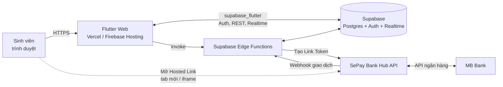
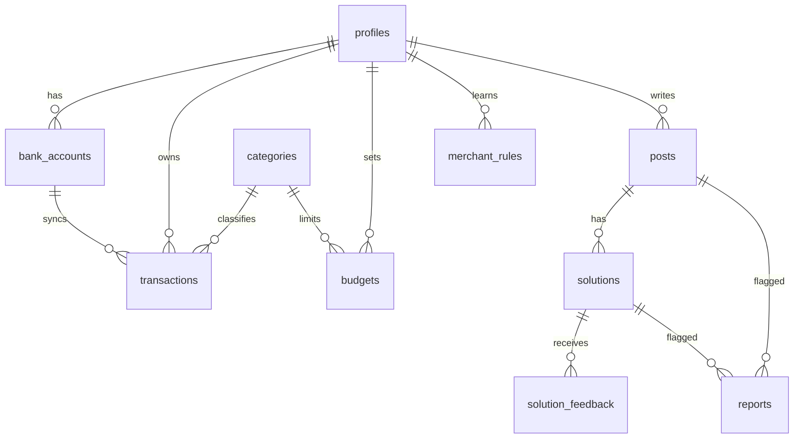
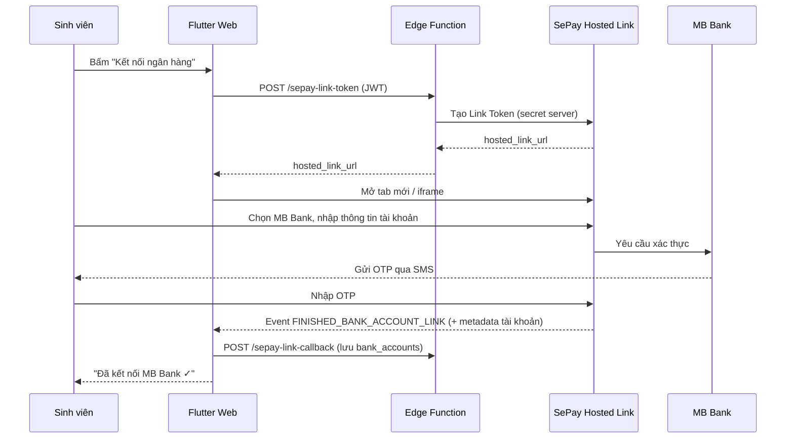

# Đặc tả hệ thống – App quản lý chi tiêu cho sinh viên (ITSS2)

> Tên tạm: **AnTâm Wallet**
> Nền tảng: **Flutter Web** (deploy qua link URL) + **Supabase** (DB, Auth, Realtime, Edge Functions) + **SePay Bank Hub** (đồng bộ giao dịch MB Bank)
> Phiên bản tài liệu: v1.0 – 17/11/2026

---

## 0. Mục lục

1. Bối cảnh & mục tiêu
2. Phạm vi MVP
3. Kiến trúc tổng thể
4. Tech stack & lý do chọn
5. Cấu trúc thư mục
6. Thiết kế cơ sở dữ liệu
7. Backend – Edge Functions
8. Tích hợp SePay Bank Hub
9. Logic nghiệp vụ (phân loại, ngân sách, đánh giá nhanh)
10. Chức năng ① – Vòng tròn "Đồng cảnh ngộ"
11. Chức năng ② – Hands-free Tracking
12. Danh sách màn hình & luồng UX
13. Nguyên tắc UX copy (giọng văn)
14. Chế độ Demo (không cần ngân hàng thật)
15. Bảo mật & quyền riêng tư
16. Biến môi trường
17. Hướng dẫn cài đặt & deploy
18. Kế hoạch test
19. Lộ trình phát triển (sprint)
20. Rủi ro & phương án dự phòng

---

## 1. Bối cảnh & mục tiêu

### 1.1 Vấn đề
Sinh viên sống tự lập phải tự quản lý chi tiêu nhưng chưa có phương pháp phù hợp. Khó khăn thường phát sinh khi ăn uống bên ngoài, đi chơi, mua sắm online hoặc gặp khoản chi ngoài dự kiến → lo lắng, căng thẳng, ảnh hưởng học tập.

### 1.2 Hai thách thức (課題) và chức năng tương ứng

| 課題 | Nội dung | Chức năng chính |
|---|---|---|
| ① | Bình tĩnh đối diện khoản chi ngoài dự kiến / vượt ngân sách, vẫn cảm thấy an tâm | **Đánh giá nhanh + Vòng tròn "Đồng cảnh ngộ"** (cộng đồng ẩn danh) |
| ② | Quản lý chi tiêu theo nhịp độ riêng, không thấy là gánh nặng, có cảm giác thành tựu & tự tin | **Hands-free Tracking** (tự đồng bộ giao dịch ngân hàng) + **Phản hồi tích cực** |

### 1.3 Luồng giá trị xuyên suốt (nối 2 chức năng)

```
Thanh toán bằng MB Bank
  → SePay đồng bộ giao dịch (②)
  → Hệ thống tự phân loại, cập nhật ngân sách (②)
  → Nếu vượt ngân sách / chi bất thường → thông báo nhẹ nhàng, KHÔNG cảnh báo đỏ
  → Màn hình "Đánh giá nhanh" (①)
  → Gợi ý bài viết cùng hoàn cảnh trong "Đồng cảnh ngộ" (①)
```

---

## 2. Phạm vi MVP

### 2.1 Trong phạm vi (Must have)
- Đăng ký / đăng nhập (email + mật khẩu hoặc Google)
- Onboarding: đặt ngân sách tháng + ngân sách theo nhóm, đánh dấu khoản "cần thiết" / "có thể điều chỉnh"
- Liên kết tài khoản ngân hàng qua SePay Bank Hub (Hosted Link)
- Nhận webhook giao dịch → lưu → tự phân loại → cập nhật realtime
- Nhập nhanh thủ công (tiền mặt, ví MoMo/ZaloPay)
- Dashboard: còn lại bao nhiêu, chi theo nhóm (tuần / tháng)
- Đánh giá nhanh sau khoản chi lớn / vượt ngân sách
- Cộng đồng ẩn danh: đăng tình huống theo mẫu, đăng giải pháp, đánh dấu hữu ích, phản hồi kết quả, báo cáo
- Phản hồi tích cực hằng tuần (streak, so sánh với tuần trước)
- **Chế độ Demo**: giả lập giao dịch không cần ngân hàng

### 2.2 Ngoài phạm vi MVP (Later)
- App mobile native, đọc thông báo biến động số dư (Android)
- Chụp hóa đơn OCR
- Gamification nâng cao (cây, thú cưng)
- Đa ngôn ngữ (JP/VN), dark mode

---

## 3. Kiến trúc tổng thể



**Nguyên tắc:**
- Flutter Web **không bao giờ** giữ secret của SePay. Mọi gọi SePay đi qua Edge Function.
- Webhook từ SePay → Edge Function `sepay-webhook` → insert vào bảng `transactions` → Supabase Realtime đẩy về Flutter.
- Toàn bộ quyền truy cập dữ liệu dùng **Row Level Security (RLS)**: user chỉ đọc/ghi dữ liệu của mình.

---

## 4. Tech stack & lý do chọn

| Lớp | Công nghệ | Lý do |
|---|---|---|
| Frontend | Flutter 3.x (Web) | Một codebase, build web để deploy link; sau này build Android/iOS |
| State management | Riverpod | Đơn giản, test được |
| Routing | go_router | Hỗ trợ URL trên web (deep link `/community/post/123`) |
| Chart | fl_chart | Biểu đồ cột/tròn |
| Backend-as-a-Service | Supabase | Postgres + Auth + Realtime + Edge Functions miễn phí gói free, không cần dựng server |
| Server logic | Supabase Edge Functions (Deno/TypeScript) | Có URL HTTPS công khai cho webhook |
| Ngân hàng | SePay Bank Hub | Hosted Link + webhook; MB Bank hỗ trợ đồng bộ tiền vào/ra |
| Hosting web | Vercel hoặc Firebase Hosting | Miễn phí, có HTTPS, custom domain |

> Phương án thay thế backend: FastAPI/NestJS deploy trên Render/Railway + Postgres. Các API trong tài liệu này giữ nguyên ý nghĩa, chỉ đổi nơi chạy.

---

## 5. Cấu trúc thư mục

```
antam-wallet/
├── app/                          # Flutter project
│   ├── lib/
│   │   ├── main.dart
│   │   ├── core/
│   │   │   ├── env.dart          # đọc --dart-define
│   │   │   ├── router.dart
│   │   │   ├── theme.dart        # màu dịu, không dùng đỏ cho cảnh báo
│   │   │   └── formatters.dart   # format VND
│   │   ├── data/
│   │   │   ├── models/           # Transaction, Budget, Category, Post, Solution...
│   │   │   └── repositories/     # gọi Supabase
│   │   ├── features/
│   │   │   ├── auth/
│   │   │   ├── onboarding/
│   │   │   ├── dashboard/
│   │   │   ├── transactions/
│   │   │   ├── bank_link/
│   │   │   ├── quick_check/      # Đánh giá nhanh (課題①)
│   │   │   ├── community/        # Đồng cảnh ngộ (課題①)
│   │   │   ├── weekly_review/    # Phản hồi tích cực (課題②)
│   │   │   └── demo/             # Giả lập giao dịch
│   │   └── widgets/
│   ├── web/index.html
│   └── pubspec.yaml
├── supabase/
│   ├── migrations/
│   │   ├── 0001_schema.sql
│   │   ├── 0002_rls.sql
│   │   └── 0003_seed_categories.sql
│   └── functions/
│       ├── sepay-link-token/index.ts
│       ├── sepay-webhook/index.ts
│       ├── demo-transaction/index.ts
│       └── weekly-review/index.ts
└── docs/
    └── SYSTEM_SPEC.md            # file này
```

---

## 6. Thiết kế cơ sở dữ liệu

### 6.1 ERD tóm tắt



### 6.2 Schema SQL (`0001_schema.sql`)

```sql
-- Hồ sơ người dùng (1-1 với auth.users)
create table profiles (
  id uuid primary key references auth.users(id) on delete cascade,
  display_name text,
  anon_alias text not null,              -- tên ẩn danh trong cộng đồng, vd "Mèo Mướp #4821"
  monthly_income_day int default 1,      -- ngày nhận tiền hằng tháng (bố mẹ gửi / lương)
  created_at timestamptz default now()
);

-- Nhóm chi tiêu
create table categories (
  id serial primary key,
  code text unique not null,             -- food, transport, shopping, rent, study, fun, other, income
  name_vi text not null,
  icon text,
  default_essential boolean default false
);

-- Ngân sách theo tháng & theo nhóm
create table budgets (
  id uuid primary key default gen_random_uuid(),
  user_id uuid not null references profiles(id) on delete cascade,
  month date not null,                   -- ngày đầu tháng, vd 2026-11-01
  category_id int references categories(id),  -- null = tổng ngân sách tháng
  amount bigint not null check (amount >= 0),
  is_essential boolean default false,    -- khoản cần thiết hay có thể điều chỉnh
  unique (user_id, month, category_id)
);

-- Tài khoản ngân hàng đã liên kết qua SePay
create table bank_accounts (
  id uuid primary key default gen_random_uuid(),
  user_id uuid not null references profiles(id) on delete cascade,
  provider text not null default 'sepay',
  provider_account_id text not null,     -- id/xid tài khoản phía SePay
  bank_short_name text,                  -- 'MBBank'
  account_number_masked text,            -- '****6789'
  status text not null default 'active', -- active | unlinked
  linked_at timestamptz default now(),
  unique (provider, provider_account_id)
);

-- Giao dịch
create table transactions (
  id uuid primary key default gen_random_uuid(),
  user_id uuid not null references profiles(id) on delete cascade,
  bank_account_id uuid references bank_accounts(id),
  source text not null,                  -- 'sepay' | 'manual' | 'demo'
  external_id text,                      -- id giao dịch phía SePay (chống trùng)
  direction text not null check (direction in ('in','out')),
  amount bigint not null check (amount > 0),   -- VND, luôn dương
  occurred_at timestamptz not null,
  raw_content text,                      -- nội dung chuyển khoản gốc
  counterparty text,                     -- tên người nhận / cửa hàng (nếu tách được)
  category_id int references categories(id),
  category_confirmed boolean default false,    -- user đã xác nhận nhóm chưa
  note text,
  balance_after bigint,                  -- số dư sau giao dịch (từ ngân hàng)
  created_at timestamptz default now(),
  unique (source, external_id)
);
create index on transactions (user_id, occurred_at desc);

-- Quy tắc phân loại học từ người dùng
create table merchant_rules (
  id uuid primary key default gen_random_uuid(),
  user_id uuid not null references profiles(id) on delete cascade,
  pattern text not null,                 -- chuỗi chuẩn hóa: 'highlands', 'shopee'
  category_id int not null references categories(id),
  hits int default 1,
  unique (user_id, pattern)
);

-- Log webhook thô (debug & audit)
create table webhook_logs (
  id bigserial primary key,
  received_at timestamptz default now(),
  payload jsonb not null,
  status text,                           -- ok | duplicate | unknown_account | error
  error text
);

-- ===== Cộng đồng "Đồng cảnh ngộ" =====
create table posts (
  id uuid primary key default gen_random_uuid(),
  author_id uuid not null references profiles(id) on delete cascade,
  difficulty_type text not null,         -- unexpected_expense | over_budget | income_delay | other
  expense_type text,                     -- medical | device_broken | social | tuition | other
  amount_range text,                     -- '<200k' | '200k-500k' | '500k-1tr' | '>1tr'
  need text not null,                    -- meal_ideas | budget_adjust | side_job | emotional | other
  body text not null check (char_length(body) between 20 and 1000),
  status text not null default 'visible',-- visible | hidden | removed
  created_at timestamptz default now()
);

create table solutions (
  id uuid primary key default gen_random_uuid(),
  post_id uuid references posts(id) on delete cascade,  -- null = mẹo chung
  author_id uuid not null references profiles(id) on delete cascade,
  tag text not null,                     -- cheap_meal | adjust_plan | side_job | mindset
  body text not null check (char_length(body) between 10 and 1000),
  helpful_count int default 0,
  status text not null default 'visible',
  created_at timestamptz default now()
);

create table solution_feedback (
  solution_id uuid references solutions(id) on delete cascade,
  user_id uuid references profiles(id) on delete cascade,
  helpful boolean not null,
  applied_result text,                   -- worked | partly | not_worked | null
  comment text,
  created_at timestamptz default now(),
  primary key (solution_id, user_id)
);

create table reports (
  id uuid primary key default gen_random_uuid(),
  reporter_id uuid not null references profiles(id),
  target_type text not null check (target_type in ('post','solution')),
  target_id uuid not null,
  reason text not null,                  -- scam_loan | spam | offensive | personal_info | other
  detail text,
  status text default 'open',            -- open | resolved | dismissed
  created_at timestamptz default now(),
  unique (reporter_id, target_type, target_id)
);

-- Tổng kết tuần (phản hồi tích cực)
create table weekly_reviews (
  id uuid primary key default gen_random_uuid(),
  user_id uuid not null references profiles(id) on delete cascade,
  week_start date not null,
  total_out bigint,
  prev_total_out bigint,
  within_budget boolean,
  streak_weeks int,
  highlights jsonb,                      -- [{type:'category_down', category:'food', pct:12}]
  unique (user_id, week_start)
);
```

### 6.3 Seed nhóm chi tiêu (`0003_seed_categories.sql`)

```sql
insert into categories (code, name_vi, icon, default_essential) values
 ('food','Ăn uống','🍜',true),
 ('rent','Nhà ở & điện nước','🏠',true),
 ('transport','Đi lại','🛵',true),
 ('study','Học tập','📚',true),
 ('shopping','Mua sắm','🛍️',false),
 ('fun','Giải trí & bạn bè','🎉',false),
 ('topup','Nạp ví điện tử','📱',false),
 ('other','Khác','📦',false),
 ('income','Tiền vào','💰',false);
```

### 6.4 RLS (`0002_rls.sql`) – tóm tắt

```sql
alter table profiles enable row level security;
alter table budgets enable row level security;
alter table bank_accounts enable row level security;
alter table transactions enable row level security;
alter table merchant_rules enable row level security;
alter table posts enable row level security;
alter table solutions enable row level security;
alter table solution_feedback enable row level security;
alter table reports enable row level security;
alter table weekly_reviews enable row level security;

-- Dữ liệu cá nhân: chỉ chủ sở hữu
create policy own_tx on transactions for all using (user_id = auth.uid()) with check (user_id = auth.uid());
create policy own_budget on budgets for all using (user_id = auth.uid()) with check (user_id = auth.uid());
create policy own_bank on bank_accounts for select using (user_id = auth.uid());
create policy own_rules on merchant_rules for all using (user_id = auth.uid()) with check (user_id = auth.uid());
create policy own_profile on profiles for all using (id = auth.uid()) with check (id = auth.uid());
create policy own_review on weekly_reviews for select using (user_id = auth.uid());

-- Cộng đồng: ai đăng nhập cũng đọc được bài 'visible'; chỉ tác giả sửa/xóa
create policy read_posts on posts for select using (status = 'visible' or author_id = auth.uid());
create policy write_posts on posts for insert with check (author_id = auth.uid());
create policy edit_posts on posts for update using (author_id = auth.uid());
-- (tương tự cho solutions)

-- QUAN TRỌNG: không trả author_id ra client. Dùng VIEW công khai:
create view public_posts as
  select p.id, pr.anon_alias, p.difficulty_type, p.expense_type, p.amount_range,
         p.need, p.body, p.created_at
  from posts p join profiles pr on pr.id = p.author_id
  where p.status = 'visible';
```

> `bank_accounts` chỉ cho **select** từ client; insert/update do Edge Function dùng service role.

### 6.5 Trigger tự ẩn bài khi bị báo cáo nhiều

```sql
create or replace function auto_hide_on_reports() returns trigger as $$
begin
  if (select count(*) from reports
      where target_type = new.target_type and target_id = new.target_id and status = 'open') >= 3 then
    if new.target_type = 'post' then
      update posts set status = 'hidden' where id = new.target_id;
    else
      update solutions set status = 'hidden' where id = new.target_id;
    end if;
  end if;
  return new;
end $$ language plpgsql security definer;

create trigger trg_auto_hide after insert on reports
for each row execute function auto_hide_on_reports();
```

---

## 7. Backend – Edge Functions

| Function | Method | Auth | Mục đích |
|---|---|---|---|
| `sepay-link-token` | POST | JWT người dùng | Tạo Link Token, trả `hosted_link_url` |
| `sepay-link-callback` | POST | JWT người dùng | Lưu tài khoản sau khi liên kết xong (từ event `FINISHED_BANK_ACCOUNT_LINK`) |
| `sepay-webhook` | POST | API key / HMAC của SePay | Nhận giao dịch mới |
| `demo-transaction` | POST | JWT người dùng | Tạo giao dịch giả lập (chế độ Demo) |
| `weekly-review` | POST (cron) | service role | Tính tổng kết tuần mỗi thứ Hai 07:00 |

### 7.1 `sepay-link-token`

**Request** (từ Flutter): `{ "purpose": "LINK_BANK_ACCOUNT" }`
**Xử lý:**
1. Xác thực JWT → lấy `user_id`
2. Gọi API tạo Link Token của SePay Bank Hub với secret ở server, gắn `user_id` vào trường định danh/metadata (để webhook biết giao dịch thuộc user nào)
3. Trả về `{ "hosted_link_url": "...", "expires_at": "..." }`

**Response lỗi:** `401` chưa đăng nhập, `502` SePay lỗi.

> ⚠️ Tên endpoint, header xác thực, tên trường chính xác: **đối chiếu tài liệu SePay Bank Hub – Quick Start** tại `developer.sepay.vn/vi/bankhub/bat-dau-nhanh` trước khi code. Tài liệu này chỉ mô tả luồng.

### 7.2 `sepay-webhook` – pseudo-code (TypeScript/Deno)

```ts
import { createClient } from "npm:@supabase/supabase-js@2";

const db = createClient(Deno.env.get("SUPABASE_URL")!, Deno.env.get("SUPABASE_SERVICE_ROLE_KEY")!);

Deno.serve(async (req) => {
  // 1. Xác thực nguồn gửi (chọn API Key hoặc HMAC theo cấu hình webhook trên SePay)
  if (!verifySepay(req)) return new Response("unauthorized", { status: 401 });

  const p = await req.json();
  await db.from("webhook_logs").insert({ payload: p, status: "received" });

  // 2. Tìm tài khoản ngân hàng → user
  const { data: acc } = await db.from("bank_accounts")
    .select("id,user_id").eq("provider_account_id", resolveAccountId(p)).eq("status", "active").maybeSingle();
  if (!acc) return ok("unknown_account");      // vẫn trả 2xx để SePay không retry vô hạn

  // 3. Chuẩn hóa
  const direction = p.transferType === "out" ? "out" : "in";
  const content = String(p.content ?? p.description ?? "");
  const counterparty = extractCounterparty(content);

  // 4. Phân loại (xem mục 9.1)
  const categoryId = direction === "in"
    ? await categoryIdByCode("income")
    : await classify(acc.user_id, content, counterparty);

  // 5. Insert, chống trùng bằng unique(source, external_id)
  const { error } = await db.from("transactions").upsert({
    user_id: acc.user_id,
    bank_account_id: acc.id,
    source: "sepay",
    external_id: String(p.id),
    direction,
    amount: Math.abs(Number(p.transferAmount)),
    occurred_at: toUtc(p.transactionDate),     // giờ VN (+07:00) → UTC
    raw_content: content,
    counterparty,
    category_id: categoryId,
    balance_after: p.accumulated ?? null,
  }, { onConflict: "source,external_id", ignoreDuplicates: true });

  if (error) return ok("error");               // log lại, vẫn 2xx; xử lý tay
  return ok("ok");
});

// SePay yêu cầu response thành công đúng định dạng, ví dụ {"success": true}
// (kiểm tra status code yêu cầu theo kiểu xác thực trong docs SePay)
function ok(status: string) {
  return new Response(JSON.stringify({ success: true }), {
    status: 200, headers: { "Content-Type": "application/json" },
  });
}
```

**Payload webhook tham khảo** (đối chiếu lại docs SePay):

```json
{
  "id": 92704,
  "gateway": "MBBank",
  "transactionDate": "2026-11-17 12:30:05",
  "accountNumber": "0123456789",
  "content": "NGUYEN VAN NAM chuyen tien tra sua",
  "transferType": "out",
  "transferAmount": 35000,
  "accumulated": 1250000,
  "referenceCode": "FT26321XXXX",
  "description": "..."
}
```

### 7.3 `demo-transaction`

**Request:** `{ "direction": "out", "amount": 35000, "content": "THANH TOAN QR HIGHLANDS COFFEE" }`
**Xử lý:** giống `sepay-webhook` bước 3–5 nhưng `source='demo'`, `external_id = uuid()`. Dùng chung hàm `classify`.

### 7.4 `weekly-review` (cron)

Chạy bằng Supabase Scheduled Functions (pg_cron) mỗi thứ Hai 07:00 (giờ VN):
1. Với mỗi user, tính `total_out` tuần trước & tuần trước nữa, theo nhóm
2. Tính `within_budget` (so với ngân sách tháng chia theo tuần)
3. `streak_weeks` = số tuần liên tiếp `within_budget = true`
4. Sinh `highlights` – **chỉ những điểm tích cực** (xem mục 11.4)

---

## 8. Tích hợp SePay Bank Hub

### 8.1 Luồng liên kết tài khoản



### 8.2 Hiển thị Hosted Link trên Flutter Web

- **Cách 1 – Tab mới (khuyên dùng, ổn định nhất):** `url_launcher` mở `hosted_link_url` với `webOnlyWindowName: '_blank'`. Sau khi liên kết xong, người dùng quay lại tab app; app gọi lại API để làm mới danh sách tài khoản (hoặc lắng nghe Realtime trên bảng `bank_accounts`).
- **Cách 2 – iframe:** dùng `HtmlElementView` + `ui_web.platformViewRegistry` để nhúng iframe, lắng nghe `window.onMessage` để nhận các event `FINISHED_BANK_ACCOUNT_LINK`, `BANKHUB_CLOSE_LINK`, `BANKHUB_TOKEN_EXPIRED`. Cần test vì trang xác thực có thể chặn iframe.

### 8.3 Cấu hình webhook trên SePay
- URL: `https://<project-ref>.supabase.co/functions/v1/sepay-webhook`
- Xác thực: API Key (đơn giản) hoặc HMAC-SHA256 (an toàn hơn)
- Bật đồng bộ **tiền vào** và **tiền ra**
- Tắt bộ lọc "chỉ giao dịch có mã thanh toán" (vì ta cần mọi giao dịch)
- Edge Function `sepay-webhook` phải deploy với `--no-verify-jwt` (SePay không có JWT Supabase)

### 8.4 Ghi chú về MB Bank
- MB Bank cá nhân: hỗ trợ tài khoản chính + đồng bộ tiền vào/ra qua SePay.
- Sandbox cho MB chưa xác nhận → khi demo dùng **Chế độ Demo** (mục 14) hoặc tài khoản demo SePay + "Giả lập giao dịch".
- Hủy liên kết: tạo Link Token với `purpose = UNLINK_BANK_ACCOUNT` → cập nhật `bank_accounts.status = 'unlinked'`.

---

## 9. Logic nghiệp vụ

### 9.1 Phân loại giao dịch tự động

Thứ tự ưu tiên:

1. **Quy tắc người dùng** (`merchant_rules`): nếu `normalize(counterparty or content)` chứa `pattern` → dùng `category_id` đó.
2. **Từ điển từ khóa chung** (hard-code trong function):

| Từ khóa (đã bỏ dấu, lowercase) | Nhóm |
|---|---|
| highlands, phuc long, tra sua, tocotoco, com, pho, bun, grabfood, shopeefood, baemin, circle k, winmart | food |
| grab, be, xanh sm, gojek, xang, petrolimex, gui xe | transport |
| shopee, lazada, tiki, tiktok shop | shopping |
| tien nha, tien phong, dien, nuoc, wifi, internet | rent |
| hoc phi, sach, photo, in tai lieu | study |
| cgv, lotte cinema, karaoke, steam, garena | fun |
| nap momo, momo, zalopay, nap vi | topup |

3. **Không khớp** → `other`, `category_confirmed = false` → app hiện thẻ "Khoản này thuộc nhóm nào?" (1 chạm). Khi user chọn → upsert `merchant_rules(pattern, category_id)` → lần sau tự động.

```ts
function normalize(s: string) {
  return s.normalize("NFD").replace(/[̀-ͯ]/g, "")
          .replace(/đ/g, "d").replace(/Đ/g, "D").toLowerCase().replace(/\s+/g, " ").trim();
}
```

### 9.2 Tính ngân sách

```
remaining_month   = budget_total(month) − Σ out(month)
remaining_cat     = budget(cat, month) − Σ out(cat, month)
days_left         = số ngày còn lại đến ngày nhận tiền tiếp theo
safe_per_day      = max(0, remaining_month − essential_left) / days_left
```

`essential_left` = tổng phần **còn lại** của các nhóm `is_essential = true`.

### 9.3 Đánh giá nhanh (Quick Check) – 課題①

**Kích hoạt khi** (bất kỳ điều kiện nào):
- Một giao dịch `out` ≥ 20% ngân sách tháng **hoặc** ≥ 3 × trung bình một giao dịch của user
- `remaining_month` chuyển từ dương sang âm
- Người dùng tự bấm "Mình vừa có khoản chi bất ngờ"

**Kết quả hiển thị (3 con số + 1 kết luận):**

| Mục | Công thức |
|---|---|
| Số tiền hiện có | `balance_after` mới nhất (hoặc ước tính = thu − chi trong tháng) |
| Khoản cần thiết còn lại | `essential_left` |
| Có thể dùng đến cuối kỳ | `available = số tiền hiện có − essential_left` |

**Mức độ ảnh hưởng:**

| Điều kiện | Mức | Thông điệp (giọng nhẹ nhàng) |
|---|---|---|
| `available / days_left ≥ 50k` | Nhẹ | "Bạn vẫn ổn. Mỗi ngày còn khoảng {x}đ để chi linh hoạt." |
| `0 < available / days_left < 50k` | Vừa | "Hơi chật một chút, nhưng xoay được. Thử điều chỉnh vài khoản bên dưới nhé." |
| `available ≤ 0` | Cần hỗ trợ | "Tháng này sẽ hơi khó. Mình cùng xem có thể lùi khoản nào, và các bạn khác đã xoay xở thế nào." |

**Gợi ý điều chỉnh:** liệt kê các nhóm `is_essential = false` còn dư ngân sách, cho phép giảm bằng slider → tính lại ngay.
**Nút cuối:** "Xem các bạn từng gặp chuyện tương tự" → mở Cộng đồng, lọc theo `difficulty_type` + `amount_range` tương ứng.

---

## 10. Chức năng ① – Vòng tròn "Đồng cảnh ngộ"

### 10.1 Tính năng tối thiểu
1. **Chia sẻ tình huống ẩn danh theo mẫu**: loại khó khăn, khoản chi phát sinh, khoảng số tiền, nhu cầu hỗ trợ, mô tả ngắn.
2. **Đăng & tìm giải pháp ngắn hạn** theo tag: bữa ăn tiết kiệm / điều chỉnh chi tiêu / việc làm thêm / tinh thần.
3. **Đánh dấu hữu ích & phản hồi kết quả áp dụng** ("Đã thử – hiệu quả / một phần / không hiệu quả").
4. **Báo cáo nội dung gây hại & kiểm duyệt**.

### 10.2 Quy tắc ẩn danh
- Chỉ hiển thị `anon_alias` (sinh ngẫu nhiên lúc đăng ký: tên con vật + số 4 chữ số).
- Không hiển thị số tiền chính xác → dùng `amount_range`.
- Client chỉ đọc qua view `public_posts` / `public_solutions` (không có `author_id`).
- Lọc trước khi đăng (client + Edge Function): chặn số điện thoại, số tài khoản, link ngoài, từ khóa vay nóng (`vay nhanh`, `vay online`, `bốc họ`, `giải ngân`, `không thẩm định`…).

### 10.3 Kiểm duyệt
- **Hậu kiểm**: bài hiển thị ngay sau khi qua bộ lọc.
- **Tự ẩn** khi ≥ 3 báo cáo mở (trigger mục 6.5).
- **Trang admin đơn giản** (route `/admin`, kiểm tra `role = 'admin'` trong `profiles`): danh sách báo cáo → Khôi phục / Gỡ bỏ.

### 10.4 Cold-start
- Seed sẵn 15–20 bài + giải pháp mẫu (do nhóm viết dựa trên Problem Interview) để cộng đồng không trống khi demo.
- Mục "Mẹo được nhiều bạn thấy hữu ích" (solutions có `helpful_count` cao, `post_id` null).

---

## 11. Chức năng ② – Hands-free Tracking

### 11.1 Tính năng tối thiểu
1. **Kết nối nguồn dữ liệu giao dịch ngân hàng** được hỗ trợ (MB Bank qua SePay), cấp quyền an toàn qua Hosted Link.
2. **Tự động đồng bộ giao dịch mới**: số tiền, thời gian, nội dung, chiều tiền vào/ra.
3. **Tổng hợp chi tiêu theo tuần/tháng**: nhóm chi chính, số tiền còn lại theo ngân sách.
4. **Phản hồi tích cực hằng tuần** (bổ sung để đáp ứng vế "thành tựu & tự tin").

### 11.2 Realtime trên Flutter

```dart
final channel = supabase.channel('tx-${user.id}')
  .onPostgresChanges(
    event: PostgresChangeEvent.insert,
    schema: 'public',
    table: 'transactions',
    filter: PostgresChangeFilter(type: PostgresChangeFilterType.eq, column: 'user_id', value: user.id),
    callback: (payload) => ref.read(transactionsProvider.notifier).onNew(payload.newRecord),
  )
  .subscribe();
```

Khi có giao dịch mới: hiện **snackbar nhẹ** "Đã ghi 35.000đ vào Ăn uống · Tuần này còn 420.000đ" + nút "Đổi nhóm".

### 11.3 Nhập nhanh thủ công
- FAB "+": số tiền (bàn phím số, gợi ý 10k/20k/50k/100k) → chọn nhóm (icon) → Lưu. Mục tiêu **< 5 giây**.
- Nguồn: tiền mặt / MoMo / ZaloPay / khác.
- Giao dịch `topup` (nạp ví từ MB) được **loại khỏi tổng chi** nếu user ghi tay các khoản tiêu trong ví (tránh đếm hai lần) – có công tắc trong Cài đặt.

### 11.4 Phản hồi tích cực (Weekly Review)
Chỉ hiển thị điểm tích cực, không chê:
- "Tuần này bạn chi Ăn uống ít hơn tuần trước 12%."
- "Bạn giữ trong ngân sách 3 tuần liên tiếp 🌱"
- "Bạn đã tự phân loại 8 khoản – app hiểu bạn hơn rồi."
- Nếu tuần tệ: "Tuần này hơi nhiều khoản phát sinh. Tuần mới, bắt đầu lại nhẹ nhàng nhé." (không hiển thị số âm, không màu đỏ)

Huy hiệu đơn giản: 1 / 4 / 8 tuần trong ngân sách; 10 / 50 giao dịch đã phân loại.

---

## 12. Danh sách màn hình & luồng UX

| # | Route | Màn hình | Nội dung chính |
|---|---|---|---|
| S1 | `/login` | Đăng nhập | Email/Google |
| S2 | `/onboarding` | Thiết lập | Ngày nhận tiền, ngân sách tháng, chia theo nhóm, đánh dấu cần thiết |
| S3 | `/` | Dashboard | Thẻ "Còn lại tháng này", "An toàn mỗi ngày", biểu đồ theo nhóm, 5 giao dịch gần nhất, thẻ phân loại chờ xác nhận |
| S4 | `/transactions` | Lịch sử | Lọc tuần/tháng/nhóm, sửa nhóm, ghi chú |
| S5 | `/bank` | Ngân hàng | Danh sách tài khoản đã liên kết, nút Kết nối / Hủy liên kết, giải thích "chỉ đọc, không chuyển tiền" |
| S6 | `/quick-check` | Đánh giá nhanh | 3 con số, mức độ ảnh hưởng, slider điều chỉnh, nút sang Cộng đồng |
| S7 | `/community` | Đồng cảnh ngộ | Tab: Tình huống / Mẹo hay; bộ lọc theo loại khó khăn & nhu cầu |
| S8 | `/community/new` | Chia sẻ | Form mẫu 5 trường |
| S9 | `/community/post/:id` | Chi tiết | Tình huống + danh sách giải pháp + nút Hữu ích / Đã thử / Báo cáo |
| S10 | `/review` | Tổng kết tuần | Highlights, streak, huy hiệu |
| S11 | `/settings` | Cài đặt | Hồ sơ, alias ẩn danh, chế độ Demo, xóa dữ liệu |
| S12 | `/demo` | Bảng giả lập | Nút tạo nhanh giao dịch mẫu |
| S13 | `/admin` | Kiểm duyệt | Danh sách báo cáo |

**Responsive:** thiết kế mobile-first (360–430px), trên desktop giới hạn `maxWidth: 480` và căn giữa để demo trên máy chiếu vẫn giống app điện thoại.

---

## 13. Nguyên tắc UX copy

| Không dùng | Dùng |
|---|---|
| "CẢNH BÁO: Bạn đã vượt ngân sách!" | "Tháng này hơi vượt dự kiến một chút. Cùng xem lại nhé?" |
| Màu đỏ, icon ⚠️ | Màu cam nhạt / tím nhạt, icon 🌿 |
| "-250.000đ" | "Vượt 250.000đ so với kế hoạch" |
| "Bạn chi tiêu quá nhiều" | "Tuần này có nhiều khoản phát sinh" |

Bảng màu gợi ý: primary `#5B8DEF`, nền `#F7F8FC`, trạng thái tốt `#3CB179`, trạng thái cần chú ý `#F2A65A` (không dùng đỏ).

---

## 14. Chế độ Demo

Mục tiêu: demo được trọn luồng **kể cả khi chưa liên kết ngân hàng thật**.

- Bật ở Cài đặt → hiện tab `/demo`.
- Các nút tạo nhanh:
  - "Trà sữa 35k" → `THANH TOAN QR TOCOTOCO` (out)
  - "Grab 42k" → `GRAB*TRIP` (out)
  - "Shopee 289k" → `SHOPEE PAY` (out)
  - "Sửa laptop 1.200k" → `CHUYEN TIEN SUA MAY TINH` (out) → **kích hoạt Quick Check**
  - "Bố mẹ gửi 3.000k" (in)
- Form tùy chỉnh: chiều, số tiền, nội dung.
- Gọi `demo-transaction` → insert vào DB → **Realtime đẩy về giống hệt giao dịch thật**.
- Nút "Xóa dữ liệu demo" (`delete from transactions where source='demo'`).

**Kịch bản thuyết trình 3 phút:**
1. Mở Dashboard (đã có dữ liệu seed 2 tuần)
2. Bấm "Trà sữa 35k" → snackbar tự ghi vào Ăn uống
3. Bấm "Sửa laptop 1.200k" → Quick Check bật lên, hiển thị mức "Vừa", slider giảm Mua sắm
4. Bấm "Xem các bạn từng gặp chuyện tương tự" → Cộng đồng lọc sẵn
5. Mở Tổng kết tuần → highlights tích cực

---

## 15. Bảo mật & quyền riêng tư

- App **chỉ đọc** giao dịch; không có chức năng chuyển tiền. Ghi rõ trên màn hình S5.
- Không lưu thông tin đăng nhập ngân hàng / OTP (do SePay xử lý).
- Số tài khoản chỉ lưu dạng che `****6789`.
- Secret SePay & `SERVICE_ROLE_KEY` chỉ nằm trong Supabase secrets, **không** đưa vào Flutter.
- Webhook: xác thực API key/HMAC, so sánh hằng thời gian, log mọi request vào `webhook_logs`.
- Chống trùng: `unique(source, external_id)`.
- Người dùng có thể: hủy liên kết ngân hàng, xóa toàn bộ giao dịch, xóa tài khoản (cascade).
- Cộng đồng: không lộ `author_id`, lọc thông tin cá nhân & quảng cáo vay.

---

## 16. Biến môi trường

**Flutter (truyền khi build bằng `--dart-define`):**
```
SUPABASE_URL=https://<project-ref>.supabase.co
SUPABASE_ANON_KEY=<anon-key>
APP_ENV=demo|prod
```

**Supabase secrets (Edge Functions):**
```
SEPAY_BANKHUB_BASE_URL=...
SEPAY_CLIENT_ID=...
SEPAY_CLIENT_SECRET=...
SEPAY_WEBHOOK_API_KEY=...        # hoặc SEPAY_WEBHOOK_HMAC_SECRET
SUPABASE_SERVICE_ROLE_KEY=...    # có sẵn trong môi trường Edge Function
```

---

## 17. Hướng dẫn cài đặt & deploy

### 17.1 Supabase
```bash
npm i -g supabase
supabase login
supabase init
supabase link --project-ref <project-ref>
supabase db push                                   # chạy migrations
supabase secrets set SEPAY_CLIENT_ID=... SEPAY_CLIENT_SECRET=... SEPAY_WEBHOOK_API_KEY=...
supabase functions deploy sepay-link-token
supabase functions deploy sepay-link-callback
supabase functions deploy demo-transaction
supabase functions deploy weekly-review
supabase functions deploy sepay-webhook --no-verify-jwt
```
Bật Realtime cho bảng `transactions` và `bank_accounts` (Dashboard → Database → Replication).

### 17.2 Flutter Web
```bash
flutter create app --platforms=web
cd app
flutter pub add supabase_flutter flutter_riverpod go_router fl_chart url_launcher intl
flutter build web --release \
  --dart-define=SUPABASE_URL=https://<ref>.supabase.co \
  --dart-define=SUPABASE_ANON_KEY=<anon> \
  --dart-define=APP_ENV=demo
```

### 17.3 Deploy lên link URL

**Firebase Hosting**
```bash
npm i -g firebase-tools
firebase login
firebase init hosting     # public dir: build/web, SPA rewrite: Yes
firebase deploy           # → https://<project>.web.app
```

**Hoặc Vercel**
```bash
npm i -g vercel
cd build/web
# tạo vercel.json để route SPA:
# { "rewrites": [{ "source": "/(.*)", "destination": "/index.html" }] }
vercel --prod             # → https://<project>.vercel.app
```

### 17.4 Sau khi deploy
- Supabase → Auth → URL Configuration: thêm domain web vào **Site URL** và **Redirect URLs** (cho đăng nhập Google).
- SePay: cấu hình webhook URL (mục 8.3), thêm domain web vào danh sách được phép (nếu Bank Hub yêu cầu cho iframe/redirect).

---

## 18. Kế hoạch test

| Loại | Trường hợp | Kỳ vọng |
|---|---|---|
| Webhook | Gửi cùng payload 2 lần | Chỉ 1 giao dịch được lưu |
| Webhook | Sai API key | 401, không ghi DB |
| Webhook | `accountNumber` chưa liên kết | 2xx, log `unknown_account` |
| Phân loại | "THANH TOAN QR HIGHLANDS" | food |
| Phân loại | Nội dung lạ → user chọn "Học tập" → giao dịch tương tự lần sau | Tự vào study |
| Ngân sách | Chi vượt tổng tháng | Quick Check bật, không hiện số âm đỏ |
| Quick Check | `available ≤ 0` | Mức "Cần hỗ trợ" + nút sang Cộng đồng |
| Cộng đồng | Đăng bài có số điện thoại | Bị chặn với thông báo nhẹ nhàng |
| Cộng đồng | 3 báo cáo | Bài tự ẩn |
| RLS | User A đọc giao dịch user B | Trả rỗng |
| Realtime | Tạo giao dịch demo | Dashboard cập nhật < 3 giây |
| Web | Mở link trên điện thoại & laptop | Layout đúng, routing F5 không lỗi 404 |

**Usability test (5 sinh viên):** đo thời gian nhập tay một khoản (< 5s), thời gian hiểu màn hình Quick Check, câu hỏi cảm xúc sau khi xem Quick Check (thang 1–5: "mức độ an tâm").

---

## 19. Lộ trình phát triển

| Sprint | Thời lượng | Đầu ra |
|---|---|---|
| 1 | 1 tuần | Supabase schema + RLS + seed; Flutter skeleton, auth, routing, theme |
| 2 | 1 tuần | Onboarding ngân sách, nhập tay, Dashboard, Lịch sử, Chế độ Demo + Realtime |
| 3 | 1 tuần | Phân loại tự động + merchant_rules; Quick Check |
| 4 | 1 tuần | Cộng đồng (đăng, giải pháp, hữu ích, báo cáo, admin) + seed nội dung |
| 5 | 1 tuần | SePay Bank Hub (link token, callback, webhook) – thử với tài khoản thật/demo |
| 6 | 1 tuần | Weekly Review, polish UX copy, deploy, usability test, chuẩn bị thuyết trình |

> Nếu thời gian gấp: Sprint 5 có thể thay bằng tài khoản demo SePay + webhook thông thường (không dùng Bank Hub), hoặc chỉ dùng Chế độ Demo.

---

## 20. Rủi ro & phương án dự phòng

| Rủi ro | Ảnh hưởng | Phương án |
|---|---|---|
| Không được cấp quyền Bank Hub / MB chưa có sandbox | Không demo được dữ liệu thật | Chế độ Demo; tài khoản demo SePay + "Giả lập giao dịch" |
| Hosted Link bị chặn trong iframe | Không liên kết được trong app | Mở tab mới (`url_launcher`) |
| Nội dung QR không có tên cửa hàng | Phân loại sai | Thẻ xác nhận 1 chạm + học `merchant_rules` |
| Sinh viên ngại cấp quyền ngân hàng | Chức năng ② không dùng được | Nhập tay vẫn đầy đủ; giải thích rõ "chỉ đọc"; đo tỷ lệ đồng ý trong usability test |
| Tiền mặt / ví điện tử không đồng bộ | Số liệu thiếu | Nhập nhanh < 5s; xử lý `topup` tránh đếm trùng |
| Cộng đồng trống lúc đầu | Người dùng rời đi | Seed nội dung; mục "Mẹo hay" |
| Nội dung lừa đảo vay nóng | Hại người dùng | Bộ lọc từ khóa, báo cáo, tự ẩn, admin |
| Phí dịch vụ SePay | Chi phí vận hành | Dùng gói thử nghiệm cho đồ án; liên hệ SePay về giá |

---

## Phụ lục A – Tài liệu tham khảo
- SePay Bank Hub – Tổng quan: https://developer.sepay.vn/en/bankhub/tong-quan
- SePay Bank Hub – Bắt đầu nhanh: https://developer.sepay.vn/vi/bankhub/bat-dau-nhanh
- SePay Webhooks: https://developer.sepay.vn/en/sepay-webhooks
- SePay – Cấu hình tài khoản ngân hàng: https://docs.sepay.vn/cau-hinh-tai-khoan-ngan-hang.html
- Supabase Flutter: https://supabase.com/docs/reference/dart
- Supabase Edge Functions: https://supabase.com/docs/guides/functions
- Flutter Web deploy: https://docs.flutter.dev/deployment/web
